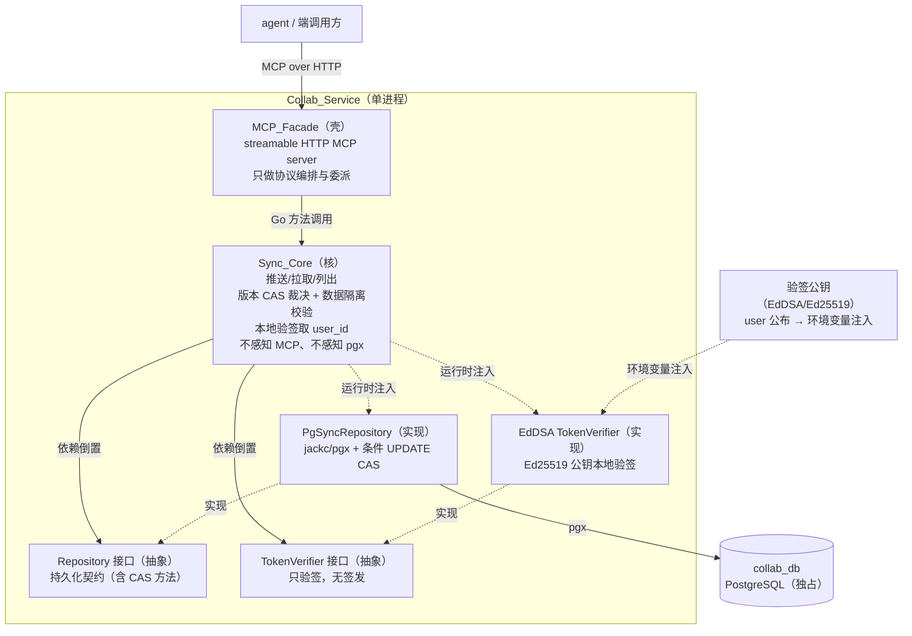
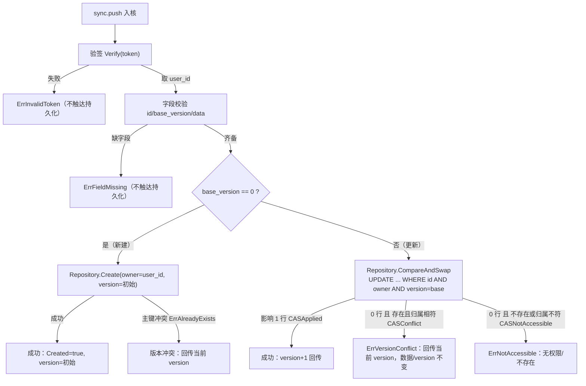

# Design Document

## Overview

一句话：**collab 服务是一层薄 MCP 门面 + 一个重同步核 + 一层 Repository 持久化，三层单向依赖，核不感知协议、不感知数据库、不签发身份只本地验签，版本裁决落在 SQL 层而非应用层锁。** 门面只把 streamable HTTP MCP 的 tool 调用翻译成对 Sync_Core 的方法调用；同步逻辑（推送、拉取、列出、乐观并发版本裁决、数据隔离校验、JWT 本地验签）全沉在核；核经 Repository 接口触达 collab_db，不认 pgx。

这与姊妹服务 user / community 同构（壳薄核重三层：MCP 门面 → 领域核 → Repository），只是领域核从 Account / Work 换成 **Sync_Object**。与 community 的两处共性原样保留，并新增一处本质差异：

- **collab 只验签、不签发**（与 community 完全一致）。身份来源唯一是 user 签发的 JWT，核接口收敛为只有 `Verify` 的 `TokenVerifier`，不含 `Sign`。
- **collab 不存密码**（与 community 完全一致）。没有 `PasswordHasher`、没有 argon2，依赖清单里不列任何密码哈希库。
- **collab 的领域本质是「带版本的乐观并发写入」**（与 user / community 的本质差异）。user 是账号、community 是只增删不改的作品，collab 是**可被多端并发写入、以单调版本号裁决冲突**的同步对象。这条不变量——「检查 base_version 与写入 version+1 必须原子，不靠应用层锁」——是本设计重点守护的核心，落在一条带 `WHERE version = base_version` 的条件 UPDATE（compare-and-swap）上。

### 这次核心是什么

- **核心**：端推送变更（带 base_version 的乐观并发写入，匹配则 +1）→ 端拉取变更（返回最新数据与 version）→ 端列出自己名下的同步对象，这条最短链路，以 MCP tool 形态暴露，身份一律取自本地验签的 JWT，访问一律经 user_id 数据隔离。
- **外围（说清为什么存在，不堆）**：
  - 本地验签不回调 user —— 存在理由：collab 不自管账号，身份来源唯一是 user 的 JWT；本地验签让 collab 零 user 依赖、零往返延迟即可认定请求者。
  - 乐观并发版本裁决（服务端不自动合并）—— 存在理由：多端并发写同一对象时，服务端只做版本裁决、绝不猜测如何合并两份用户态数据，把合并权交还给最懂数据语义的端。MVP 用整对象版本，字段级 diff 与 CRDT/OT 后置。
  - 版本 CAS 落在 SQL 层 —— 存在理由：两端并发推送若在应用层「先读 version 再写」，两者可能都读到相同的旧 version、都通过校验、后写覆盖先写——丢更新。把「检查+写入+version+1」压成数据库一条条件 UPDATE 的原子操作，是消灭丢更新的根，不需应用层互斥锁、不需串行化全表。
  - 数据隔离 —— 存在理由：用户态数据（工程、设置）只归属主可访问，任何持有合法 JWT 的人都不能碰他人名下的 Sync_Object。
  - TLS 强制 + dev 可关 —— 存在理由：公网不裸奔，内网开发不被阻塞，差异收敛在配置不分叉代码。

### 与 requirements 的一处对齐（身份契约来源）

collab 本地验签依赖 user 公布的「验签公钥 + 身份契约」（算法 EdDSA/Ed25519、user_id 声明字段 `sub`）。与 user / community design 的 JWT 契约一致：`algorithm = "EdDSA"`、`user_id_claim = "sub"`。本设计中验签公钥经**环境变量注入** collab（见配置），启动时加载进 `TokenVerifier`、缺失即 fail fast；collab 不在运行时调用 user 的 `account.verification_contract` tool 拉取——MVP 以环境变量注入公钥这一静态方式最简、零运行期耦合。公钥轮转时重启注入新值。此为设计期对「公钥如何到达 collab」的收敛，与 requirements Req 2.4（经环境变量获取验签公钥）、Req 9.4 完全一致，与 community 同构。

## Architecture

三层单向依赖，上层依赖下层/抽象，下层绝不反向依赖上层。验签公钥经环境变量在组装点注入，不入库不进仓库。



依赖方向的硬约束：

- `Facade → Core`：门面 import 核，核绝不 import 门面。核里没有一个 MCP 类型。
- `Core → Repository(接口)` 与 `Core → TokenVerifier(接口)`：核 import 的是接口，不 import pgx、不 import 具体验签库。pgx 只出现在 Repository 的 PG 实现包；Ed25519 验签只出现在 TokenVerifier 的实现里。
- 组装点在 `cmd/`：由 main 把 `PgSyncRepository`、`EdDSA TokenVerifier`（公钥来自环境变量）注入 `Sync_Core`，把 `Sync_Core` 注入 `MCP_Facade`。依赖倒置的「倒」就倒在这个组装点。

### 微内核 / plugin 的落点

- **微内核** = Sync_Core 的机制（推送编排、版本裁决、数据隔离、拉取/列表编排、持久化编排），稳定不动。
- **plugin 式替换点**：Repository（换库 = 换实现）、TokenVerifier（换验签算法/公钥源）。核只依赖这两个接口，实现可替换、可单测 mock。

### 并发安全的落点（本服务核心，先行声明）

乐观并发版本裁决在本设计里不是「核里读一下 version 再写」，而是**整体下沉到 Repository 的一条条件 UPDATE**：

```
UPDATE sync_objects
   SET data = $newData, version = version + 1, updated_at = now()
 WHERE sync_object_id = $id
   AND owner_user_id  = $userID     -- 数据隔离也进同一条语句
   AND version        = $baseVersion
```

- 受影响行数 = 1 → CAS 命中：写入成功、version 原子 +1，返回新 version。
- 受影响行数 = 0 → CAS 落空：要么 base_version 不等于当前 version（版本冲突），要么 owner 不符/对象不存在（无权限/不存在）。核据此分支（分支判定见「关键流程」与「数据隔离与版本冲突的检查顺序」）。

这条语句的原子性由数据库单行 UPDATE 的行级一致性保证：两端携带**同一个 base_version** 并发推送时，数据库对该行的两次条件 UPDATE 串行化执行——第一条把 version 从 `b` 改成 `b+1`、影响 1 行；第二条的 `WHERE version = b` 此时已不成立、影响 0 行。于是**恰好一个成功、一个冲突，version 只 +1，丢更新不可能发生**。应用层不需要任何互斥锁、不需要 `SELECT ... FOR UPDATE` 显式加锁、不需要串行化隔离级别。这是乐观并发在 SQL 层的标准落地，也是本服务与 user/community「普通 INSERT/SELECT/DELETE」最大的工程差异。

## Components and Interfaces

### 层一：MCP_Facade（壳）

职责：起 streamable HTTP MCP server；注册 3 个 tool；把每个 tool 调用的入参解成核的请求结构，调核，把核的返回/错误翻译回 MCP 结果。**不做任何同步业务判定**（判定全在核，包括验签、数据隔离、版本裁决、字段校验）。

对外 3 个 MCP tool（对应 3 项对外能力）：

| tool name | 对应能力 | 委派到 Core |
|---|---|---|
| `sync.push` | 推送变更（Req 3、Req 4） | `Push` |
| `sync.pull` | 拉取变更（Req 5） | `Pull` |
| `sync.list` | 列出同步对象（Req 6） | `List` |

门面接口（Go）：

```go
// internal/facade
package facade

// MCPServer 是壳。它持有一个 syncobj.Sync 核接口，把 tool 调用委派进去。
// 它只认 syncobj.Sync 这个接口，不认核的具体实现。
type MCPServer struct {
    core syncobj.Sync
}

func NewMCPServer(core syncobj.Sync) *MCPServer

// Serve 起 streamable HTTP MCP server，阻塞直至关闭。
// 传输安全（TLS 开关）从 Config 来，见 Error Handling / 配置。
func (s *MCPServer) Serve(ctx context.Context, cfg TransportConfig) error
```

门面对每个 tool 的处理一律是三步：解参 → 调 core → 译结果。tool handler 内不得出现验签、比对归属 user_id、比对 version、判定对象是否存在这类业务分支。三个 tool 均把 raw JWT 原样透传给核，门面自己不验签。

### 层二：Sync_Core（核）

职责：承载全部同步业务。这是「核重」所在。核只依赖两个下层抽象：`Repository`、`TokenVerifier`。

> **命名坑（本服务特有）**：领域包不叫 `sync`——`sync` 是 Go 标准库包名，领域包同名会与 `import "sync"` 冲突、给核内任何并发原语的使用埋坑。领域包取 **`syncobj`**（Sync_Object 的收敛），下文所有核代码在 `package syncobj`。

```go
// internal/syncobj
package syncobj

// Sync 是核对外（对门面）暴露的唯一接口。门面只认这一个接口。
// 三个方法的入参都含 raw JWT——核内先本地验签取请求者 user_id，再执行。
type Sync interface {
    // Push 推送变更：验签取 user_id → 数据隔离校验 → 版本 CAS（匹配则 +1，否则冲突）。
    // 对不存在的 sync_object_id 且为新建语义时，创建新 Sync_Object（归属=JWT user_id）。
    Push(ctx context.Context, token string, in PushInput) (PushResult, error)
    // Pull 拉取变更：验签取 user_id → 数据隔离校验 → 返回最新数据与 version。
    Pull(ctx context.Context, token string, in PullInput) (PullResult, error)
    // List 列出请求者名下所有 Sync_Object（每项含 sync_object_id 与当前 version）。
    List(ctx context.Context, token string) (ListResult, error)
}

// 推送入参：目标对象 + 基准版本 + 新数据。不含归属 user_id——身份只来自 JWT。
type PushInput struct {
    SyncObjectID string // 目标对象标识；新建语义下由端生成并携带（见「新建 vs 更新」）
    BaseVersion  int64  // 本次变更所基于的版本号；新建语义用初始值 0（见下）
    Data         []byte // 新数据（整对象，MVP 不做字段级 diff）
}

// 推送结果：写入后的最新 version。冲突时经 error 回传最新 version（见 Error Handling）。
type PushResult struct {
    SyncObjectID string
    Version      int64 // 成功写入后的最新 version
    Created      bool  // 本次是否为新建（true=新建，false=更新既有对象）
}

// 拉取入参：目标对象 + 端已知版本（可选，用于判定端是否已最新）。
type PullInput struct {
    SyncObjectID string
    KnownVersion *int64 // 端已知的 version，nil 表示无条件拉取（Req 5.2）
}

// 拉取结果：最新数据 + 当前 version + 端是否已最新。
type PullResult struct {
    SyncObjectID string
    Data         []byte
    Version      int64
    UpToDate     bool // 服务端 version <= KnownVersion 时为 true（端已持有最新，Req 5.2）
}

// 列表结果：请求者名下对象清单，每项含标识与当前 version（不带数据体，清单从简）。
type ListResult struct {
    Items []SyncObjectSummary
}

type SyncObjectSummary struct {
    SyncObjectID string
    Version      int64
}
```

核依赖的两个替换点接口：

```go
// 持久化抽象（依赖倒置核心，Req 8.1）
type Repository interface {
    // Create 创建一个新 Sync_Object（初始 version=初始值）。
    // sync_object_id 主键冲突（并发双新建同 id）返回 ErrAlreadyExists——新建的并发兜底。
    Create(ctx context.Context, rec SyncObjectRecord) error

    // CompareAndSwap 是版本裁决的核心：一条带 WHERE version=base AND owner=userID 的条件 UPDATE。
    // 返回：
    //   (newVersion, Applied)        受影响 1 行：CAS 命中，version 已 +1。
    //   (currentVersion, Conflict)   受影响 0 行且对象存在且归属相符：base_version 不匹配，回传当前 version。
    //   (0, NotOwnedOrMissing)       对象不存在或归属不符：无权限/不存在（口径见下）。
    // 实现用单条 UPDATE + （必要时）一次归属/存在性探查来区分后两种 0 行成因。
    CompareAndSwap(ctx context.Context, id, ownerUserID string, baseVersion int64, data []byte) (CASResult, error)

    // FindOwned 按归属取对象全量；对象不存在或归属不符统一返回 ErrNotAccessible（口径见下）。
    FindOwned(ctx context.Context, id, ownerUserID string) (SyncObjectRecord, error)

    // ListByOwner 返回某 owner_user_id 名下所有对象的摘要（sync_object_id + version）。
    ListByOwner(ctx context.Context, ownerUserID string) ([]SyncObjectSummary, error)
}

// CAS 结果判别。
type CASOutcome int

const (
    CASApplied         CASOutcome = iota // 命中：version +1
    CASConflict                          // base_version 不匹配：版本冲突
    CASNotAccessible                     // 对象不存在或归属不符：无权限/不存在
)

type CASResult struct {
    Outcome    CASOutcome
    NewVersion int64 // Applied 时为 +1 后的新版本；Conflict 时为服务端当前 version（回传给端）
}

// 验签替换点（只验签，无签发——与 user 的 TokenSigner 的本质差异，与 community 同构）
type TokenVerifier interface {
    // Verify 用注入的 Ed25519 公钥按身份契约本地验证签名与有效期，
    // 通过则返回 Claims（含 user_id）；失败/过期/格式非法返回 ErrInvalidToken。
    // 全程不回调 user（Req 2.2）。
    Verify(token string) (Claims, error)
}

// Claims 是从 JWT 取出的请求者身份。collab 只读不造。
type Claims struct {
    UserID string // 取自契约约定的 user_id 声明字段（sub）
}

// SyncObjectRecord 是持久化视图（核与 Repository 之间的数据契约）。
type SyncObjectRecord struct {
    SyncObjectID string
    OwnerUserID  string
    Data         []byte
    Version      int64
    CreatedAt    time.Time
    UpdatedAt    time.Time
}
```

核的构造（组装点在 cmd 注入两个依赖）：

```go
func NewSyncCore(repo Repository, verifier TokenVerifier, clk Clock) Sync
```

- `Clock` 抽出来是为了让 `created_at` / `updated_at` 与「JWT 过期」在 PBT 里可控、可快进。
- 不需 `IDGenerator`：sync_object_id 由端携带（新建语义），collab 不代端签发对象标识（与 community 的 work_id 由核签发相反——这里对象的「名字」归端，collab 只认归属与版本）。

### 层三：Repository 的 PG 实现

职责：用 jackc/pgx 实现 `Repository` 接口访问 collab_db。pgx 只在这一个包里出现。版本 CAS 的 SQL 原子性在此落地。

```go
// internal/syncobj/pgrepo
package pgrepo

type PgSyncRepository struct {
    pool *pgxpool.Pool
}

func NewPgSyncRepository(pool *pgxpool.Pool) *PgSyncRepository
// 实现 syncobj.Repository 的四个方法。
// CompareAndSwap 用一条 UPDATE ... WHERE sync_object_id=$1 AND owner_user_id=$2 AND version=$3
//   RETURNING version 执行：RETURNING 非空 → CASApplied（version 已 +1）；
//   RETURNING 空 → 再以 FindOwned 探查成因：对象存在且归属相符 → CASConflict（回传当前 version）；
//   否则 → CASNotAccessible。
// Create 捕获 sync_object_id 主键唯一冲突，译为 syncobj.ErrAlreadyExists（并发双新建兜底）。
// FindOwned 命中空结果（不存在或归属不符）统一译为 syncobj.ErrNotAccessible。
```

### 层旁：TokenVerifier 的 EdDSA 实现

职责：用环境变量注入的 Ed25519 公钥，按 user 身份契约（EdDSA、`sub`）本地验 JWT。只验签，不含任何签发路径。与 community 完全一致。

```go
// internal/syncobj（与核同包的替换点实现，或独立小包；Ed25519/JWT 细节只在此出现）
type EdDSAVerifier struct {
    publicKey   ed25519.PublicKey // 由环境变量注入的 PEM 公钥解析而来
    userIDClaim string            // "sub"
}

func NewEdDSAVerifier(pemPublicKey string, userIDClaim string) (*EdDSAVerifier, error)
// 实现 syncobj.TokenVerifier：解析并验证 JWT 签名（EdDSA）与 exp，
// 取 userIDClaim 字段作 UserID。公钥缺失/非法在构造期 fail fast。
```

## Data Models

### Sync_Object 在 collab_db 的 schema

单表 `sync_objects`（MVP 领域核只有 Sync_Object 一个实体，不提前拆表）：

```sql
CREATE TABLE sync_objects (
    sync_object_id UUID        PRIMARY KEY,              -- 全局唯一标识，由端携带（Req 3.1）；主键兜底并发双新建
    owner_user_id  TEXT        NOT NULL,                 -- 归属 user_id，取自 JWT，创建时写定不可变（Req 3.3 / 7.1）
    data           BYTEA       NOT NULL,                 -- 整对象数据本体（Req 3.2），不透明字节
    version        BIGINT      NOT NULL,                 -- 单调递增版本号，每次成功写入 +1（Req 3.5）
    created_at     TIMESTAMPTZ NOT NULL DEFAULT now(),
    updated_at     TIMESTAMPTZ NOT NULL DEFAULT now()
);

-- list 按 owner_user_id 查其名下全部对象是 MVP 唯一的清单形态，为其建索引。
CREATE INDEX idx_sync_objects_owner ON sync_objects (owner_user_id);
```

版本 CAS 的更新语句（本服务核心，原子落地）：

```sql
-- 推送（更新既有对象）：检查 base_version + 写入 + version+1 一条原子 UPDATE。
-- 归属校验（owner_user_id）并入同一 WHERE，与版本校验一次完成。
UPDATE sync_objects
   SET data = $4, version = version + 1, updated_at = now()
 WHERE sync_object_id = $1
   AND owner_user_id  = $2
   AND version        = $3          -- $3 = base_version
RETURNING version;                  -- 返回 +1 后的新 version
-- RETURNING 有行 → CASApplied；RETURNING 无行 → 以 FindOwned 探查是冲突还是无权限/不存在。
```

设计决策：

- **sync_object_id 用 UUID、由端携带**。与 community 的 work_id 由核签发相反：Sync_Object 的「名字」是端的工程/设置标识，端在本地创建对象时就定了 id；collab 不代端签发，只认「这个 id 归谁、现在什么版本」。主键约束在并发双新建同 id 时兜底唯一（捕获冲突译 `ErrAlreadyExists`）。
- **data 存 BYTEA（而非 JSONB）**。理由：collab 同步的是**不透明的用户态数据本体**（工程、设置），MVP 按整对象版本推拉、服务端绝不解析/合并/按字段查询其内容（Req 4.3 不自动合并、无字段级 diff）。BYTEA 不假设数据是 JSON、不强加结构校验、对端自由编码（二进制工程文件、加密数据皆可）最中立；JSONB 会隐含「数据是合法 JSON 且可被 PG 解析/索引」的假设，与「服务端不碰内容语义」相悖，且对非 JSON 数据反而是负担。将来若需服务端按字段裁决（字段级 diff）再评估 JSONB——那是明确的后置翻盘项。
- **version 用 BIGINT**。单调递增、每次成功写入 +1，BIGINT 空间对单对象版本计数绰绰有余；初始值见下。
- **owner_user_id 存 TEXT**。user_id 来源唯一是 user 的 JWT `sub` 声明，collab 只认不解释其内部结构（与 community 同构，按不透明字符串存最稳）。创建时写定，之后无任何写路径改它（Req 3.3）——CAS 的 UPDATE 不含 owner 列的赋值，核也不提供改归属的方法。
- **version CAS 不靠应用层锁、不靠显式行锁**。单行条件 UPDATE 的行级原子性已足够（见 Architecture 的并发安全落点）。不引入 `SELECT ... FOR UPDATE`、不升隔离级别，保持写路径最短、并发吞吐最高。

### 新建 vs 更新：两条路径如何区分，且都并发安全

push 对「对象已存在」与「对象尚不存在」走两条路径，由 **base_version 是否为初始值 0** 区分（口径写死）：

- **初始 version 约定为 0**：新建的 Sync_Object 保存后 version 即为初始值。端新建对象时携带 `base_version = 0`。
- **`base_version == 0` → 新建语义**：核走 `Repository.Create` 插入新行（owner=JWT user_id、version=初始值、data=新数据）。
  - 并发安全：两端同时对同一个（端自选的）sync_object_id 发起新建，两条 `Create` 竞争主键——PRIMARY KEY 约束保证只有一条插入成功，另一条撞唯一冲突返回 `ErrAlreadyExists`。不丢、不覆盖。
  - 若端用 `base_version==0` 新建一个**已存在**的 id：`Create` 撞主键冲突返回 `ErrAlreadyExists`，核译为版本冲突（该 id 已非初始态，端应改走拉取后以真实 base_version 更新）。
- **`base_version > 0` → 更新语义**：核走 `Repository.CompareAndSwap`，执行上文的条件 UPDATE。
  - 命中（`version==base_version` 且归属相符）→ 写入 + version+1。
  - 落空 → 冲突或无权限/不存在，按下节口径分支。

> 为什么用 base_version==0 而非「先查 id 是否存在再决定建/更新」：先查后建存在 TOCTOU 窗口（查时不存在、建时已被别人建），还得靠主键冲突兜底——那不如直接让「0 即新建」语义化、把并发兜底统一交给数据库约束（主键之于新建、条件 UPDATE 之于更新），两条路径各有其 SQL 层原子保证，核不做任何跨语句的「查了再写」。

## Correctness Properties


*一条属性是在系统所有合法执行中都应成立的特征或行为——是对「系统应当做什么」的形式化陈述。属性把人读的规格和机器可验的正确性保证连接起来。*

下列属性经 prework 分析后去冗得到（推送成功的「写入+版本+1」与「单调递增」合并为一条版本不变量；版本冲突的「拒绝写入」「不覆盖」「不合并」「回传最新 version」合并为一条冲突不变量；拉取的「返回最新数据与 version」与「据 known_version 判定端是否最新」合并为一条拉取属性；数据隔离的推送面与拉取面合并为一条隔离不变量；结构/配置/传输类需求以静态检查、示例、集成、冒烟覆盖、不转属性）。每条属性经单个 property-based test 实现，最少 100 次迭代；Repository 用内存实现（内存实现须同样以原子 CAS 语义建模，使并发属性在无数据库下亦可验）、TokenVerifier 用测试签名器（持测试私钥签 JWT、核持对应公钥验签）以压低成本。

### Property 1: 门面委派保真

*For any* 合法的 MCP tool 调用，MCP_Facade 处理后应恰好调用 Sync_Core 的对应方法一次，且入参原样透传、门面自身不做任何业务判定（不验签、不比对归属、不比对版本、不判定对象存在）。

**Validates: Requirements 1.3, 1.4**

### Property 2: 验签取值正确

*For any* 用 user 私钥对任一 user_id 签发的有效 JWT，Sync_Core 本地验签后提取的请求者 user_id 应等于签入该 JWT 的 user_id（全程不回调 user）。

**Validates: Requirements 2.1**

### Property 3: 坏 JWT 被拒且无副作用

*For any* 被篡改、已过期或格式非法的 JWT，推送、拉取、列出都应返回凭证无效错误，且不改变 collab_db 中任何 Sync_Object 数据（不新增、不改版本、不改数据）。

**Validates: Requirements 2.3**

### Property 4: 缺字段推送被拒且无副作用

*For any* 缺少 sync_object_id、base_version 或新数据的推送输入（携带有效 JWT），推送应返回字段缺失错误，且 collab_db 中不新增对象、不改动任何既有对象的数据与 version。

**Validates: Requirements 3.4**

### Property 5: 版本匹配则写入且版本单调 +1

*For any* 归属请求者的既有 Sync_Object 与等于其当前 version 的 base_version，推送应成功写入新数据、返回的最新 version 恰等于原 version + 1，且该对象 version 的整个历史严格单调递增、仅在每次成功写入时 +1（从不跳变、从不回退）。

**Validates: Requirements 3.1, 3.2, 3.5**

### Property 6: 新建往返且归属写定

*For any* 不存在的 sync_object_id、base_version=0 的新建推送与任一 user_id 签发的有效 JWT，推送应创建新 Sync_Object 并以初始 version 保存；随后以同一 JWT 拉取该对象应取回与推送一致的数据，且其归属 user_id 等于该 JWT 的 user_id。

**Validates: Requirements 3.3**

### Property 7: 版本冲突拒绝、不覆盖、不合并、回传最新

*For any* 归属请求者的既有 Sync_Object 与不等于其当前 version 的 base_version，推送应判为版本冲突：返回冲突错误并回传服务端当前最新 version、collab_db 中该对象的数据与 version 均保持不变（既不被新数据覆盖，也不与新数据做任何自动合并）。

**Validates: Requirements 4.1, 4.2, 4.3, 4.4**

### Property 8: 并发同 base_version 推送恰一个成功、丢更新不发生

*For any* 归属请求者的既有 Sync_Object，当两次推送携带相同的 base_version（均等于当前 version）并发到达时，恰有一次返回成功（version +1）、另一次返回版本冲突（回传已 +1 的最新 version），且对象最终 version 恰为原 version + 1（绝不 +2、绝不发生「后写覆盖先写」的丢更新）。

**Validates: Requirements 3.5, 4.1**

### Property 9: 数据隔离——非属主被拒且数据不变

*For any* 归属某 user_id 的 Sync_Object 与任一不等于其归属的请求者 JWT，该请求者对该对象的推送与拉取都应被拒（返回无权限/不存在，不区分对象是否存在），且 collab_db 中该对象的数据与 version 保持不变。

**Validates: Requirements 7.1, 7.2, 7.4**

### Property 10: 列表只含自己的对象且版本如实

*For any* 多归属的 Sync_Object 集合与任一请求者 JWT，列表返回的每一项其归属 user_id 都等于该 JWT 的 user_id（绝不含他人对象），该请求者名下的对象在列表中不被漏掉，且每项的 version 等于该对象服务端当前 version。

**Validates: Requirements 6.1, 6.2, 7.3**

### Property 11: 拉取返回最新数据与版本并如实判定端是否最新

*For any* 归属请求者的既有 Sync_Object，拉取应返回该对象服务端当前的数据与 version；当携带的端已知 version 低于服务端 version 时返回最新数据且标记端未最新，当端已知 version 不低于服务端 version 时标记端已最新。

**Validates: Requirements 5.1, 5.2**

### Property 12: 拉取不存在被拒

*For any* 归属请求者但在 collab_db 中不存在的 sync_object_id，拉取应返回同步对象不存在错误。

**Validates: Requirements 5.3**

## 关键流程

### 推送（sync.push）——重点：数据隔离与版本 CAS 的检查顺序

检查顺序写死：**先验签取 user_id → 再校验字段 → 再做归属校验与版本 CAS（两者并入同一条 SQL）**。顺序理由见下方「检查顺序」小节。

1. 门面把 raw JWT、`sync_object_id`、`base_version`、`data` 原样透传给核，**门面不验签、不判任何业务**，调 `Core.Push(token, in)`。
2. 核 `TokenVerifier.Verify(token)`：验签 + 过期校验；失败→ `ErrInvalidToken`（Req 2.3），**不触达持久化**。
3. 从 claims 取 `sub` 作请求者 user_id（Req 2.1）。
4. 核校验必填字段：`sync_object_id` 非空、`base_version` 存在、`data` 非空；缺任一→ `ErrFieldMissing`（Req 3.4），**不触达持久化**。
5. **分路（新建 vs 更新，由 base_version 区分）**：
   - `base_version == 0`（新建语义，Req 3.3）：核组 `SyncObjectRecord`（owner=请求者 user_id、version=初始值 0、data=新数据），调 `Repository.Create`。
     - 成功 → 返回 `{sync_object_id, version: 0→初始, Created: true}`。
     - 撞主键冲突 `ErrAlreadyExists` → 该 id 已存在，译为版本冲突（回传该对象当前 version，端应改走拉取再更新）。
   - `base_version > 0`（更新语义）：核调 `Repository.CompareAndSwap(id, userID, baseVersion, data)`，一条条件 UPDATE 同时做**归属校验 + 版本校验 + 写入 + version+1**（Req 3.1/3.2/7.1）：
     - `CASApplied`（影响 1 行）→ 返回 `{sync_object_id, version: 新值, Created: false}`（Req 3.2/3.5）。
     - `CASConflict`（0 行、对象存在且归属相符、version≠base）→ 版本冲突：返回 `ErrVersionConflict` 并回传当前 version，数据与 version 不变（Req 4.1/4.2/4.3/4.4）。
     - `CASNotAccessible`（0 行、对象不存在或归属不符）→ `ErrNotAccessible`（无权限/不存在，Req 7.2）。



### 拉取（sync.pull）

1. 门面把 raw JWT、`sync_object_id`、可选 `known_version` 原样透传给核，调 `Core.Pull(token, in)`。
2. 核 `TokenVerifier.Verify(token)`：失败→ `ErrInvalidToken`（Req 2.3），**不触达持久化**。
3. 从 claims 取 `sub` 作请求者 user_id。
4. 核 `Repository.FindOwned(id, userID)`：以归属取对象（数据隔离一次完成，Req 7.1）。
   - 对象不存在或归属不符 → `ErrNotAccessible`（不存在/无权限，Req 5.3/7.2；口径见下）。
5. 取回对象：返回 `{data, version}`；若携带 `known_version` 且 `known_version >= version` → `UpToDate: true`（端已最新，Req 5.2），否则返回最新数据并 `UpToDate: false`（Req 5.1）。

### 列出（sync.list）

1. 门面把 raw JWT 原样透传给核，调 `Core.List(token)`。
2. 核 `TokenVerifier.Verify(token)`：失败→ `ErrInvalidToken`（Req 2.3）。
3. 从 claims 取 `sub` 作请求者 user_id。
4. 核 `Repository.ListByOwner(userID)`：只查 owner_user_id = 请求者 user_id 的对象（数据隔离落在 WHERE，Req 6.2/7.3），返回每项 `{sync_object_id, version}`（Req 6.1）。核内无任何不带 owner 过滤的列表路径（Req 7.4）。

### 数据隔离与版本冲突的检查顺序（口径写死）

**顺序：验签取 user_id → 归属校验 → 版本 CAS。** 归属校验在版本校验之前（且在更新路径里两者并入同一条 `WHERE owner AND version` 的 SQL 一次完成）。

- **为什么归属先于版本**：版本冲突会回传服务端最新 version——这是对象的真实状态信息。若对非属主也先做版本校验再回传 version，等于把「该对象当前什么版本、是否存在」泄露给无权者。归属先行，确保非属主在任何路径上都拿不到对象的版本/存在性信息。
- **归属校验失败的对外口径：统一返回「无访问权限 / 不存在」，不区分「对象不存在」与「对象存在但不归你」。** 理由：若「存在但不归你」返回「无权限」、而「不存在」返回「不存在」，攻击者可据两种错误的差异枚举出「某 sync_object_id 是否存在、归属于某人」——这是一条对象存在性侧信道。统一口径堵死它（与 user 登录「凭据无效不可区分」、community 的隔离思路同源）。实现上 `FindOwned` 与 `CompareAndSwap` 的「不存在」与「归属不符」两种 0 命中都收敛到同一个 `ErrNotAccessible`。
  - 注：Req 5.3 文字区分「对象不存在」错误。本设计在**归属校验语境**下（请求者 user_id 已知、要判对象归不归他）统一为 `ErrNotAccessible`，对外信息不泄露存在性；这不与 Req 5.3 冲突——对合法属主拉取自己确不存在的对象，返回的仍是「不存在」语义，只是错误类型与「非属主访问他人对象」归一，以堵侧信道。此为设计期对 Req 5.3 与 Req 7.2 口径的统一收敛，建议回填 requirements 注明两者共用一个对外错误。

## Error Handling

错误处理策略：错误在核里分类，门面只做翻译，不新增业务错误。核的错误集（稳定、可被端/测试断言）：

| 错误 | 触发 | 对外信息 | 为什么这样 |
|---|---|---|---|
| `ErrInvalidToken` | JWT 验签失败/过期/格式非法（推送、拉取、列出） | 「登录状态无效，请重新登录」 | 不区分「签名坏」与「已过期」，不给攻击者可利用的细分 |
| `ErrFieldMissing` | 推送缺 sync_object_id / base_version / data | 「同步对象标识、基准版本与数据不能为空」 | 明确指引，无安全敏感 |
| `ErrVersionConflict` | 推送 base_version ≠ 服务端当前 version（含新建撞已存在 id） | 「版本冲突，请拉取最新后重试」，**附回传的最新 version** | 端据最新 version 拉取、端上合并后以新 base_version 重传（Req 4.4）；version 必须回传，故该错误携带数据 |
| `ErrNotAccessible` | 归属不符 **或** 对象不存在（推送/拉取的归属语境） | 「同步对象不存在或无访问权限」 | **两路合一**：不暴露对象是否存在这条侧信道（见检查顺序小节，Req 7.2） |

硬策略：

- **验签前置、无副作用**：三个能力都先验签，验签失败即 `ErrInvalidToken`，绝不触达持久化。坏 JWT 不产生任何落库/改版本（Property 3 守护）。
- **版本裁决原子、无应用层锁**：更新路径的「归属+版本校验+写入+version+1」是数据库一条条件 UPDATE，受影响行数即裁决结果；新建路径靠主键约束兜底。核内不存在「先 SELECT version 再 UPDATE」的跨语句读改（那正是丢更新的根，Property 8 守护其不发生）。
- **冲突回传最新 version**：`ErrVersionConflict` 必须携带服务端当前 version，否则端无从得知该拉到哪个版本（Req 4.1/4.4）。这是本服务唯一「错误值带数据」的错误。
- **归属先于版本、口径归一**：归属校验在版本校验之前，归属失败与对象不存在统一为 `ErrNotAccessible`，不泄露对象存在性（Property 9 守护）。
- **门面不吞错、不改语义**：门面把核错误映射为 MCP 的 `isError` 结果，保留错误类别与冲突回传的 version，但不把核内部细节（堆栈、SQL、JWT 内部字段）外泄。
- **fail fast 于启动**：验签公钥 / DB 凭据缺失、公网未配 TLS，一律启动期报错退出，不运行到一半才暴露。

## Testing Strategy

PBT 适用性判断：Sync_Core 是近乎纯的业务逻辑（版本单调不变量、CAS 裁决、并发恰一成功、数据隔离、拉取/列表往返、坏 JWT 不变量），Repository 与 TokenVerifier 均为可替换接口、可用内存实现/测试签名器 mock，行为随输入显著变化——**PBT 适用，对核**。门面的协议编排、Repository 的 pgx 实现、TLS/配置属于传输与外部依赖——**PBT 不适用，用示例/集成/冒烟**。

### 属性测试（对 Sync_Core）

- 库：**rapid**（`pgregory.net/rapid`，Go 原生 property-based 库）。不自实现。
- 每条 Property（1–12）由**单个** property-based test 实现，最少 **100** 次迭代。
- 每个属性测试加注释标签：`// Feature: mvp-sync, Property {number}: {property_text}`。
- 测试跑在内存 Repository + 测试 TokenVerifier（测试私钥签 JWT、核持对应公钥验签）之上，与 I/O 解耦。
- `Clock` 注入假时钟，使 Property 3 的「过期」可控、可快进。
- **并发属性（Property 8）怎么测**：内存 Repository 的 `CompareAndSwap` 必须以**原子语义**建模——用一把每对象的互斥量或 `sync/atomic`（在 pgrepo 之外、属于内存实现细节，不污染核）把「比较 base_version 与写入 +1」包成不可分操作，复刻数据库单行 UPDATE 的行级原子性。测试并发启动两个 goroutine 携带相同 base_version 对同一对象 `Push`，用 `WaitGroup` 汇合后断言：恰一个返回成功、一个返回 `ErrVersionConflict`，且对象最终 version == 原 version + 1（而非 +2）。对真实数据库的同一不变量放到集成测试再验一次（见下），确保内存建模与 PG 行为一致。

### 示例 / 单元测试

覆盖结构与具体场景（不转属性的部分）：

- tool 注册表恰含 `sync.push` / `sync.pull` / `sync.list` 三个约定 tool（Req 1.2）。
- 静态依赖检查：`internal/facade` 无业务判定（Req 1.4）；`internal/syncobj` 不 import MCP/传输包、不 import pgx（Req 1.5 / 8.1）；核无签发逻辑、`TokenVerifier` 无 `Sign`（Req 2.5）。
- 领域包名为 `syncobj`，核内不出现与标准库 `sync` 的 import 冲突（命名坑的静态守护）。
- `data` 列为 BYTEA、核不解析 data 内容（无字段级 diff / 自动合并路径，Req 4.3）。
- 新建 vs 更新的分路：`base_version==0` 走 Create、`>0` 走 CompareAndSwap（与 Property 5/6/7 互补的结构检查）。
- 配置加载：缺验签公钥/DB 凭据→启动失败；公网未配 TLS→启动失败；dev 明文可启动（Req 2.4 / 9.1 / 9.2 / 9.3 / 9.4）。

### 集成测试（对 pgx 实现与 collab_db）

- 针对容器化 PostgreSQL，跑 `PgSyncRepository` 的 Create / CompareAndSwap / FindOwned / ListByOwner 往返（1–3 例，含：CAS 命中 +1、CAS 版本不匹配 0 行→冲突、归属不符 0 行→ `ErrNotAccessible`、Create 主键冲突→ `ErrAlreadyExists` 的映射）（Req 8.2）。
- **并发丢更新的真库验证**：开两条连接携带同一 base_version 对同一行并发 `CompareAndSwap`，断言数据库层恰一条影响 1 行、另一条影响 0 行，行最终 version 只 +1——在真实 PG 上复核 Property 8 的 SQL 层原子性（本服务最关键的工程保证，必须在真库跑过）。
- 一条端到端：起门面（MCP over HTTP）→ push 新建 → pull 取回 → push 带正确 base_version 更新（version+1）→ push 带过期 base_version（冲突、回传最新）→ list 确认名下对象与版本；并验非属主 push/pull 被拒，贯通整条链路与数据隔离。

### 冒烟测试

- 启动门面确认 streamable HTTP MCP server 监听、tool 列表非空（Req 1.1）。
- 连接目标为 collab_db、无 user/community 库连接（Req 8.3）。

## 目录结构

常规 Go 服务布局，与 user / community 服务同构：`cmd/` 放可执行入口与组装，`internal/` 按领域分包，领域核与传输/持久化各自独立包，依赖方向单向向下。**领域包名为 `syncobj`，不叫 `sync`——`sync` 是 Go 标准库包名，同名会与 `import "sync"` 冲突。**

```
services/collab/
├── cmd/
│   └── collab-service/
│       └── main.go              # 唯一组装点：装配 Config→pgxpool→PgSyncRepo + EdDSAVerifier(公钥来自环境变量)→Core→MCPServer，起 Serve
├── internal/
│   ├── facade/                  # 壳：streamable HTTP MCP server + 3 个 tool handler
│   │   ├── server.go            # MCPServer, NewMCPServer, Serve
│   │   └── tools.go             # 3 个 tool（push/pull/list）的解参/委派/译结果（无业务判定）
│   ├── syncobj/                 # 核：Sync_Object 领域核（核重所在）。包名避开标准库 sync
│   │   ├── sync_core.go         # Sync 接口 + 实现（Push/Pull/List）
│   │   ├── model.go             # SyncObjectRecord/PushInput/PushResult/PullInput/PullResult/ListResult/SyncObjectSummary/CASResult/Claims 结构
│   │   ├── errors.go            # ErrInvalidToken/ErrFieldMissing/ErrVersionConflict/ErrNotAccessible/ErrAlreadyExists
│   │   ├── repository.go        # Repository 接口（持久化抽象，含 CompareAndSwap CAS 方法）
│   │   ├── verifier.go          # TokenVerifier 接口（只 Verify）+ EdDSA/Ed25519 实现
│   │   └── pgrepo/              # Repository 的 pgx 实现（pgx 只在此出现；版本 CAS 的条件 UPDATE 落此）
│   │       └── pg_repository.go # PgSyncRepository
│   └── config/
│       └── config.go            # 环境变量加载：验签公钥/DB 凭据/TLS 开关；fail fast
├── migrations/
│   └── 0001_sync_objects.sql    # sync_objects 表 DDL
├── go.mod
└── go.sum
```

领域边界落点：`syncobj` 是领域核一个包（DDD 的 Sync_Object 领域），`facade` 是传输壳，`pgrepo` 是持久化实现。核不感知另两者。不提前拆多领域包（MVP 领域核只有 Sync_Object）。`TokenVerifier` 与核同包（它是核的替换点接口），Ed25519/JWT 细节收敛在 `verifier.go`，不外泄进门面或 Repository。**版本 CAS 的 SQL 原子性只在 `pgrepo/pg_repository.go`（真库）与内存 Repository（测试）两处落地，核只调 `CompareAndSwap` 接口、不感知其锁机制。**

## 依赖清单（锁版本）

按工程准则第八条，新依赖的安装由总架构评估（主流、维护活跃、许可宽松、非 typosquatting）后安装验证。本清单依赖已由总架构批准。MCP Go SDK 选型已确定：`github.com/modelcontextprotocol/go-sdk` v1.8.0（全系统一，与 team-service / iot-cloud / build-service 全系一致）。锁版本口径为**精确 pin（=x.y.z，不开 caret）**，与 user / community 服务对齐版本号。

| 依赖 | 锁定版本 | 用途 | 状态 |
|---|---|---|---|
| Go module 名 `github.com/xt-line/maker-kit/maker-cloud/services/collab` | — | 本服务 module | 本仓库自有 |
| Go toolchain | 1.27+ | 语言/运行时 | 已锁定（总架构） |
| `github.com/jackc/pgx/v5` | v5.7.2 | PostgreSQL 驱动 + 连接池（pgxpool）；版本 CAS 的条件 UPDATE 经此执行 | **已批准** |
| `github.com/golang-jwt/jwt/v5` | v5.2.1 | JWT 本地验签（EdDSA/Ed25519，只用验签路径） | **已批准** |
| `golang.org/x/crypto` | v0.31.0 | Ed25519 公钥解析辅助（PEM/`crypto/ed25519` 配合） | **已批准** |
| `github.com/google/uuid` | v1.6.0 | sync_object_id（UUID）解析/校验（对象标识由端携带，collab 校验其为合法 UUID） | **已批准** |
| `github.com/modelcontextprotocol/go-sdk` | v1.8.0 | 对外 streamable HTTP MCP server | **已批准（总架构统一选型，与 team-service / iot-cloud / build-service 全系一致）** |
| `pgregory.net/rapid` | v1.3.0 | property-based 测试（仅测试依赖） | **已批准** |

三点说明：

1. **不列 argon2 / 任何密码哈希库**：collab 不自管账号、不存密码，没有 user 服务的 `PasswordHasher` / `golang.org/x/crypto/argon2` 需求。`golang.org/x/crypto` 在此仅用于 Ed25519 公钥处理，不涉及 argon2（与 community 同口径）。
2. **只验签不签发**：Ed25519 验签原语由标准库 `crypto/ed25519` 提供，`golang-jwt/jwt/v5` 负责 JWT 解析与验签封装；collab 不使用其签发路径，接口层也只暴露 `Verify`（与 community 同构）。
3. **MCP Go SDK 选型**：已确定 `github.com/modelcontextprotocol/go-sdk` v1.8.0（全系统一）。collab 对外走 streamable HTTP MCP，与 team-service / iot-cloud / build-service 全系一致，统一门面写法。锁版本口径为精确 pin（=x.y.z，不开 caret）。
