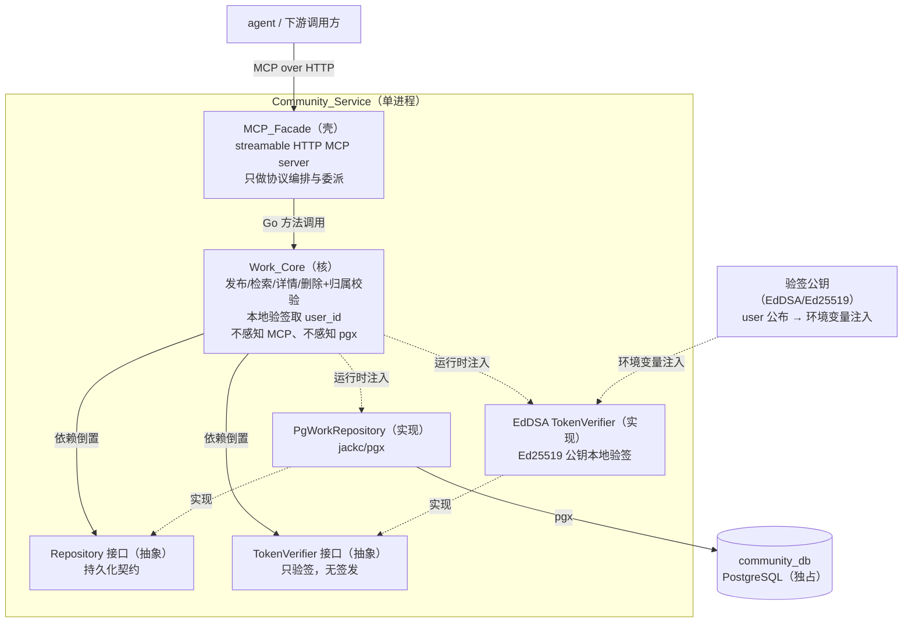

# Design Document

## Overview

一句话：**community 服务是一层薄 MCP 门面 + 一个重作品核 + 一层 Repository 持久化，三层单向依赖，核不感知协议、不感知数据库、不签发身份只本地验签。** 门面只把 streamable HTTP MCP 的 tool 调用翻译成对 Work_Core 的方法调用；作品逻辑（发布、检索、详情、删除及归属校验、JWT 本地验签）全沉在核；核经 Repository 接口触达 community_db，不认 pgx。

这与姊妹服务 user 同构（壳薄核重三层：MCP 门面 → 领域核 → Repository），只是领域核从 Account 换成 Work。两处关键差异写死在本文：

- **community 只验签、不签发**。user 既签发又验签（`TokenSigner` 有 `Sign`+`Verify`）；community 只需本地验 user 签发的 JWT，接口收敛为只有 `Verify` 的 `TokenVerifier`，不照搬 `Sign`。
- **community 不存密码**。没有 `PasswordHasher`、没有 argon2，依赖清单里不列任何密码哈希库。

### 这次核心是什么

- **核心**：发布作品 → 分页检索列表 → 看详情 → 删自己的作品（带归属校验），这条最短链路，以 MCP tool 形态暴露，身份一律取自本地验签的 JWT。
- **外围（说清为什么存在，不堆）**：
  - 本地验签不回调 user —— 存在理由：community 不自管账号，身份来源唯一是 user 的 JWT；本地验签让 community 零 user 依赖、零往返延迟即可认定操作者。
  - 删除归属校验 —— 存在理由：作品删除权只归发布者，防止任意持有合法 JWT 的人删他人作品。这是 Requirement 6 的实质，也是本设计重点守护的不变量。
  - 只存产物引用不存二进制 —— 存在理由：community 是作品社区不是对象存储，MVP 只记 URL + 元信息，二进制托管后置。
  - TLS 强制 + dev 可关 —— 存在理由：公网不裸奔，内网开发不被阻塞，差异收敛在配置不分叉代码。

### 与 requirements 的一处对齐（身份契约来源）

community 本地验签依赖 user 公布的「验签公钥 + 身份契约」（算法 EdDSA/Ed25519、user_id 声明字段 `sub`）。与 user design 的 JWT 契约一致：`algorithm = "EdDSA"`、`user_id_claim = "sub"`。本设计中验签公钥经**环境变量注入** community（见配置），启动时加载进 `TokenVerifier`；community 不调用 user 的 `account.verification_contract` tool 在运行时拉取——MVP 以环境变量注入公钥这一静态方式最简、零运行期耦合。公钥轮转时重启注入新值。此为设计期对「公钥如何到达 community」的收敛，与 requirements Req 2.4（经环境变量获取验签公钥）完全一致。

## Architecture

三层单向依赖，上层依赖下层/抽象，下层绝不反向依赖上层。验签公钥经环境变量在组装点注入，不入库不进仓库。



依赖方向的硬约束：

- `Facade → Core`：门面 import 核，核绝不 import 门面。核里没有一个 MCP 类型。
- `Core → Repository(接口)` 与 `Core → TokenVerifier(接口)`：核 import 的是接口，不 import pgx、不 import 具体验签库。pgx 只出现在 Repository 的 PG 实现包；Ed25519 验签只出现在 TokenVerifier 的实现里。
- 组装点在 `cmd/`：由 main 把 `PgWorkRepository`、`EdDSA TokenVerifier`（公钥来自环境变量）注入 `Work_Core`，把 `Work_Core` 注入 `MCP_Facade`。依赖倒置的「倒」就倒在这个组装点。

### 微内核 / plugin 的落点

- **微内核** = Work_Core 的机制（发布编排、归属校验、检索分页、持久化编排），稳定不动。
- **plugin 式替换点**：Repository（换库 = 换实现）、TokenVerifier（换验签算法/公钥源）。核只依赖这两个接口，实现可替换、可单测 mock。

## Components and Interfaces

### 层一：MCP_Facade（壳）

职责：起 streamable HTTP MCP server；注册 4 个 tool；把每个 tool 调用的入参解成核的请求结构，调核，把核的返回/错误翻译回 MCP 结果。**不做任何作品业务判定**（判定全在核，包括验签、归属校验、字段校验）。

对外 4 个 MCP tool（对应 4 项对外能力）：

| tool name | 对应能力 | 委派到 Core |
|---|---|---|
| `work.publish` | 发布作品（Req 3） | `Publish` |
| `work.list` | 检索作品列表（Req 4） | `List` |
| `work.get` | 查看作品详情（Req 5） | `Get` |
| `work.delete` | 删除自己的作品（Req 6） | `Delete` |

门面接口（Go）：

```go
// internal/facade
package facade

// MCPServer 是壳。它持有一个 work.Work 核接口，把 tool 调用委派进去。
// 它只认 work.Work 这个接口，不认核的具体实现。
type MCPServer struct {
    core work.Work
}

func NewMCPServer(core work.Work) *MCPServer

// Serve 起 streamable HTTP MCP server，阻塞直至关闭。
// 传输安全（TLS 开关）从 Config 来，见 Error Handling / 配置。
func (s *MCPServer) Serve(ctx context.Context, cfg TransportConfig) error
```

门面对每个 tool 的处理一律是三步：解参 → 调 core → 译结果。tool handler 内不得出现验签、比对发布者 user_id、判定作品是否存在这类业务分支。`work.publish` / `work.delete` 把 raw JWT 原样透传给核，门面自己不验签。

### 层二：Work_Core（核）

职责：承载全部作品业务。这是「核重」所在。核只依赖两个下层抽象：`Repository`、`TokenVerifier`。

```go
// internal/work
package work

// Work 是核对外（对门面）暴露的唯一接口。门面只认这一个接口。
type Work interface {
    // Publish 入参含 raw JWT。核内先本地验签取发布者 user_id，再校验字段、签发 work_id、落库。
    Publish(ctx context.Context, token string, in PublishInput) (PublishResult, error)
    // List 不需身份，按过滤与分页返回摘要列表。
    List(ctx context.Context, q ListQuery) (ListResult, error)
    // Get 按 work_id 返回详情，不需身份。
    Get(ctx context.Context, workID string) (WorkDetail, error)
    // Delete 入参含 raw JWT 与 work_id。核内先验签取操作者 user_id，查归属，比对后删或拒。
    Delete(ctx context.Context, token string, workID string) error
}

// 发布入参：作品元信息 + 产物引用。不含发布者 user_id——身份只来自 JWT。
type PublishInput struct {
    Title       string             // 标题，必填（Req 3.4）
    Description string             // 描述，可空
    Artifacts   []ArtifactRef      // 产物引用，至少一条（Req 3.5）
}

type PublishResult struct {
    WorkID string // 核签发的全局唯一 work_id
}

// 列表检索入参：简单过滤 + 分页。无全文搜索（Req 4.5）。
type ListQuery struct {
    PublisherUserID *string // 可选：按发布者 user_id 过滤（Req 4.2），nil 表示不过滤
    Limit           int     // 每页条数（分页参数，Req 4.3）
    Offset          int     // 偏移（分页参数，Req 4.3）
}

type ListResult struct {
    Items []WorkSummary // 当前页的作品摘要
}

// 列表项是摘要（不必带全部产物元信息），详情才给全量。
type WorkSummary struct {
    WorkID          string
    Title           string
    PublisherUserID string
    CreatedAt       time.Time
}

// 详情含元信息、产物引用与发布者 user_id（Req 5.1）。
type WorkDetail struct {
    WorkID          string
    Title           string
    Description     string
    Artifacts       []ArtifactRef
    PublisherUserID string
    CreatedAt       time.Time
}

// 产物引用：URL + 必要元信息，不含二进制本体（Req 3.3）。
type ArtifactRef struct {
    URL      string // 指向产物的 URL（如 .cavo 工程文件、缩略图）
    Kind     string // 产物类型标识，如 "project" / "thumbnail"
    MimeType string // 可选，便于下游呈现
}
```

核依赖的两个替换点接口：

```go
// 持久化抽象（依赖倒置核心，Req 7.1）
type Repository interface {
    // Create 落库一件 Work（含 work_id、发布者 user_id、元信息、产物引用）。
    Create(ctx context.Context, w WorkRecord) error
    // List 按过滤与分页返回摘要；分页参数已由核校验合法。
    List(ctx context.Context, q ListQuery) ([]WorkSummary, error)
    // FindByID 返回一件 Work 全量；不存在返回 ErrWorkNotFound。
    FindByID(ctx context.Context, workID string) (WorkRecord, error)
    // Delete 删除指定 work_id 的 Work；不存在返回 ErrWorkNotFound。
    // Delete 只按 work_id 删，归属判定在核完成后才调用——Repository 不承载归属逻辑。
    Delete(ctx context.Context, workID string) error
}

// 验签替换点（只验签，无签发——与 user 的 TokenSigner 的本质差异）
type TokenVerifier interface {
    // Verify 用注入的 Ed25519 公钥按身份契约本地验证签名与有效期，
    // 通过则返回 Claims（含 user_id）；失败/过期/格式非法返回 ErrInvalidToken。
    // 全程不回调 user（Req 2.2）。
    Verify(token string) (Claims, error)
}

// Claims 是从 JWT 取出的操作者身份。community 只读不造。
type Claims struct {
    UserID string // 取自契约约定的 user_id 声明字段（sub）
}

// WorkRecord 是持久化视图（核与 Repository 之间的数据契约）。
type WorkRecord struct {
    WorkID          string
    Title           string
    Description     string
    Artifacts       []ArtifactRef
    PublisherUserID string
    CreatedAt       time.Time
}
```

核的构造（组装点在 cmd 注入两个依赖）：

```go
func NewWorkCore(repo Repository, verifier TokenVerifier, clk Clock, idgen IDGenerator) Work
```

- `Clock` 抽出来是为了让 `created_at` 与「JWT 过期」在 PBT 里可控、可快进。
- `IDGenerator` 抽出来是为了 work_id 签发可注入（测试里可用确定序列验唯一性），生产用 UUID v4。

### 层三：Repository 的 PG 实现

职责：用 jackc/pgx 实现 `Repository` 接口访问 community_db。pgx 只在这一个包里出现。

```go
// internal/work/pgrepo
package pgrepo

type PgWorkRepository struct {
    pool *pgxpool.Pool
}

func NewPgWorkRepository(pool *pgxpool.Pool) *PgWorkRepository
// 实现 work.Repository 的四个方法。
// work_id 唯一性靠 community_db 的 PRIMARY KEY 约束兜底。
// FindByID / Delete 命中空结果时译为 work.ErrWorkNotFound。
```

### 层旁：TokenVerifier 的 EdDSA 实现

职责：用环境变量注入的 Ed25519 公钥，按 user 身份契约（EdDSA、`sub`）本地验 JWT。只验签，不含任何签发路径。

```go
// internal/work（与核同包的替换点实现，或独立小包；Ed25519/JWT 细节只在此出现）
type EdDSAVerifier struct {
    publicKey    ed25519.PublicKey // 由环境变量注入的 PEM 公钥解析而来
    userIDClaim  string            // "sub"
}

func NewEdDSAVerifier(pemPublicKey string, userIDClaim string) (*EdDSAVerifier, error)
// 实现 work.TokenVerifier：解析并验证 JWT 签名（EdDSA）与 exp，
// 取 userIDClaim 字段作 UserID。公钥缺失/非法在构造期 fail fast。
```

## Data Models

### Work 在 community_db 的 schema

单表 `works`（MVP 领域核只有 Work 一个实体，不提前拆表）。产物引用是「一件作品对多条引用」，用 JSONB 列内聚存储——MVP 不需对产物引用做关系查询（无全文搜索、无按产物检索），内聚存储最简且避免过早拆子表：

```sql
CREATE TABLE works (
    work_id          UUID        PRIMARY KEY,              -- 核签发的全局唯一标识（Req 3.6）
    publisher_user_id TEXT       NOT NULL,                 -- 发布者 user_id，取自 JWT，发布时写定不可变（Req 3.1/3.7）
    title            TEXT        NOT NULL,                 -- 作品标题，必填（Req 3.4）
    description      TEXT        NOT NULL DEFAULT '',      -- 作品描述，可空
    artifacts        JSONB       NOT NULL,                 -- 产物引用数组：[{url, kind, mime_type}]，只存引用不存二进制（Req 3.3）
    created_at       TIMESTAMPTZ NOT NULL DEFAULT now()
);

-- 列表按发布者过滤 + 按发布时间分页是 MVP 唯一检索形态，为其建索引。
CREATE INDEX idx_works_publisher ON works (publisher_user_id);
CREATE INDEX idx_works_created_at ON works (created_at DESC);
```

设计决策：

- **work_id 用 UUID（v4）**。理由：Community_Service 是 work_id 唯一签发者（Req 3.6），UUID 可在核侧本地生成、无需协调即全局唯一、不泄露发布顺序/规模（相比自增 ID）。生成放在核（`Publish` 内经 `IDGenerator`），不依赖 DB 序列，保证「签发权在核」而非「签发权在库」；PRIMARY KEY 约束在并发下兜底唯一。
- **publisher_user_id 存 TEXT**。user_id 来源唯一是 user 的 JWT `sub` 声明，community 只认不解释其内部结构（user 用 UUID，但 community 不该硬绑这一假设），按不透明字符串存最稳。发布时从 JWT 写入，之后无任何写路径改它（Req 3.7：发布后不可变——核不提供修改发布者的方法，表上也无 update 该列的路径）。
- **artifacts 用 JSONB**。产物引用是值对象集合、随作品整体读写、MVP 无独立查询需求，内聚进 Work 行最简；只存 `{url, kind, mime_type}` 等引用元信息，绝不存二进制本体（Req 3.3）。
- **无 updated_at**。MVP 作品不支持编辑（无更新能力需求），发布即定、只增删不改，故不设更新时间列；将来若开放编辑再加。

## Correctness Properties


*一条属性是在系统所有合法执行中都应成立的特征或行为——是对「系统应当做什么」的形式化陈述。属性把人读的规格和机器可验的正确性保证连接起来。*

下列属性经 prework 分析后去冗得到（发布与详情往返合并为「发布往返」，缺标题/缺产物引用合并为「缺字段」，删除归属的成功面与拒绝面合并为一条双向属性守护最关键的安全不变量，结构/配置类需求以静态检查、示例、冒烟、集成覆盖、不转属性）。每条属性经单个 property-based test 实现，最少 100 次迭代；Repository 用内存实现、TokenVerifier 用测试签名器（持测试私钥签 JWT、核持对应公钥验签）以压低成本。

### Property 1: 门面委派保真

*For any* 合法的 MCP tool 调用，MCP_Facade 处理后应恰好调用 Work_Core 的对应方法一次，且入参原样透传、门面自身不做任何业务判定（不验签、不比对发布者、不判定作品存在）。

**Validates: Requirements 1.3**

### Property 2: 验签取值正确

*For any* 用 user 私钥对任一 user_id 签发的有效 JWT，Work_Core 本地验签后提取的操作者 user_id 应等于签入该 JWT 的 user_id（全程不回调 user）。

**Validates: Requirements 2.1**

### Property 3: 坏 JWT 被拒且无副作用

*For any* 被篡改、已过期或格式非法的 JWT，发布与删除都应返回凭证无效错误，且不改变 community_db 中任何作品数据（不新增、不删除）。

**Validates: Requirements 2.3**

### Property 4: 发布往返

*For any* 合法的作品元信息与产物引用，以及任一 user_id 签发的有效 JWT，发布成功后按返回的 work_id 查看详情应查回一件作品，其标题、描述、产物引用与发布输入一致，其发布者 user_id 等于该 JWT 的 user_id。

**Validates: Requirements 3.1, 3.2, 5.1**

### Property 5: 缺必填字段被拒且无副作用

*For any* 标题为空/全空白、或产物引用为空的发布输入（携带有效 JWT），发布应返回字段缺失错误，且 community_db 中不新增任何作品。

**Validates: Requirements 3.4, 3.5**

### Property 6: work_id 全局唯一

*For any* 发布序列，所有发布成功所签发的 work_id 两两互不相同。

**Validates: Requirements 3.6**

### Property 7: 发布者 user_id 不可变

*For any* 已发布作品，在其后任意次数的详情读取与列表检索之后，该作品的发布者 user_id 始终等于发布时 JWT 的 user_id（核不提供任何修改发布者的路径）。

**Validates: Requirements 3.7**

### Property 8: 发布者过滤只返回该发布者的作品

*For any* 多发布者的作品集合与任一发布者 user_id 过滤值，带该过滤值的列表检索返回的每一项其发布者 user_id 都等于该过滤值，且该发布者的作品在合法分页范围内不被漏掉。

**Validates: Requirements 4.1, 4.2**

### Property 9: 分页不重不漏

*For any* 作品集合与任一合法分页参数，单页返回条数不超过 limit、结果顺序稳定，且在稳定顺序下逐页拼接恰好不重不漏地覆盖符合条件的全集。

**Validates: Requirements 4.3**

### Property 10: 非法分页被拒

*For any* 非法分页参数（负 limit、负 offset、limit 超过上限等），列表检索应返回分页参数非法错误且不返回任何作品数据。

**Validates: Requirements 4.4**

### Property 11: 详情不存在被拒

*For any* community_db 中不存在的 work_id，查看详情应返回作品不存在错误。

**Validates: Requirements 5.2**

### Property 12: 删除归属

*For any* 已发布作品：当操作者 JWT 的 user_id 等于该作品发布者 user_id 时，删除应成功且随后查看详情返回作品不存在；当操作者 JWT 的 user_id 不等于发布者 user_id 时，删除应返回无删除权限错误、且该作品仍可被查看详情（不被删除）。

**Validates: Requirements 6.1, 6.2, 6.3, 6.5**

### Property 13: 删除不存在被拒

*For any* community_db 中不存在的 work_id（携带有效 JWT），删除应返回作品不存在错误。

**Validates: Requirements 6.4**

## 关键流程

### 发布（work.publish）

1. 门面收到 tool 调用，解出 raw JWT、`title`、`description`、`artifacts`，调 `Core.Publish(token, in)`。
2. 核 `TokenVerifier.Verify(token)`：验签 + 过期校验；失败→ `ErrInvalidToken`（Req 2.3），**不落库**。
3. 从 claims 取 `sub` 作发布者 user_id（Req 2.1）。
4. 核校验必填字段：`title` 非空白（否则 `ErrFieldMissing`，Req 3.4）、`artifacts` 非空（否则 `ErrFieldMissing`，Req 3.5）。
5. 核经 `IDGenerator` 本地生成 UUID 作 work_id（Req 3.6），经 `Clock` 取 created_at。
6. 核组 `WorkRecord`（发布者 user_id 写定，Req 3.7），调 `Repository.Create` 落库（Req 3.2）；产物引用只存 URL+元信息（Req 3.3）。
7. 核返回 `{work_id}`，门面译为 tool 结果。

### 检索列表（work.list）

1. 门面解出可选 `publisher_user_id`、`limit`、`offset`，调 `Core.List(q)`（无需 JWT）。
2. 核校验分页参数合法（limit>0 且 ≤ 上限、offset≥0），非法→ `ErrInvalidPagination`（Req 4.4）。
3. 核调 `Repository.List(q)`：按 `publisher_user_id` 过滤（若提供，Req 4.2）、按 created_at 稳定排序、按 limit/offset 分页（Req 4.3）。
4. 核返回摘要列表（Req 4.1）。无全文搜索路径（Req 4.5）。

### 详情（work.get）

1. 门面解出 `work_id`，调 `Core.Get(work_id)`（无需 JWT）。
2. 核调 `Repository.FindByID`；不存在→ `ErrWorkNotFound`（Req 5.2）。
3. 核返回 `WorkDetail`（元信息 + 产物引用 + 发布者 user_id，Req 5.1）。

### 删除（work.delete）——重点：归属校验

1. 门面把 raw JWT 与 `work_id` 原样透传给核，**门面不验签、不判归属**，调 `Core.Delete(token, work_id)`。
2. 核 `TokenVerifier.Verify(token)`：验签 + 过期校验；失败→ `ErrInvalidToken`（Req 2.3），**不删**。
3. 从 claims 取 `sub` 作操作者 user_id。
4. 核 `Repository.FindByID(work_id)`：不存在→ `ErrWorkNotFound`（Req 6.4），**不删**。
5. **归属比对**（Req 6.1）：取查回作品的发布者 user_id，与步骤 3 的操作者 user_id 逐字符比对。
   - 相等（Req 6.2）：核调 `Repository.Delete(work_id)` 删除，返回成功。随后该 work_id 的 `Get` 应返回不存在。
   - 不等（Req 6.3）：核返回 `ErrForbidden`（无删除权限），**不调 `Repository.Delete`**，作品原样保留。
6. 删除路径唯一且归属校验前置（Req 6.5）：`Repository.Delete` 只按 work_id 删、不承载归属逻辑；核内不存在任何跳过步骤 5 的删除分支。

## Error Handling

错误处理策略：错误在核里分类，门面只做翻译，不新增业务错误。核的错误集（稳定、可被下游/测试断言）：

| 错误 | 触发 | 对外信息 | 为什么这样 |
|---|---|---|---|
| `ErrInvalidToken` | JWT 验签失败/过期/格式非法（发布、删除） | 「登录状态无效，请重新登录」 | 不区分「签名坏」与「已过期」，不给攻击者可利用的细分 |
| `ErrFieldMissing` | 发布缺标题或缺产物引用 | 「标题与产物引用不能为空」 | 明确指引，无安全敏感 |
| `ErrForbidden` | 删除时操作者 user_id ≠ 发布者 user_id | 「无权删除该作品」 | 归属校验失败如实告知；作品存在与否对发布者不敏感，可直言无权限 |
| `ErrWorkNotFound` | 详情/删除的 work_id 不存在 | 「作品不存在」 | 作品可见性公开，告知不存在无副作用 |
| `ErrInvalidPagination` | 列表分页参数越界 | 「分页参数非法」 | 明确指引调用方修正 |

硬策略：

- **验签前置、无副作用**：发布与删除都先验签，验签失败即返回 `ErrInvalidToken`，绝不触达持久化。坏 JWT 不产生任何落库/删除（Property 3 守护）。
- **删除归属前置、路径唯一**：删除必先查归属再决定删或拒，核内无绕过归属的删除分支（Property 12 守护）。
- **门面不吞错、不改语义**：门面把核错误映射为 MCP 的 `isError` 结果，保留错误类别，但不把核内部细节（堆栈、SQL、JWT 内部字段）外泄。
- **fail fast 于启动**：验签公钥 / DB 凭据缺失、公网未配 TLS，一律启动期报错退出，不运行到一半才暴露。

## Testing Strategy

PBT 适用性判断：Work_Core 是近乎纯的业务逻辑（发布往返、归属校验、唯一性、分页不重不漏、坏 JWT 不变量），Repository 与 TokenVerifier 均为可替换接口、可用内存实现/测试签名器 mock，行为随输入显著变化——**PBT 适用，对核**。门面的协议编排、Repository 的 pgx 实现、TLS/配置属于传输与外部依赖——**PBT 不适用，用示例/集成/冒烟**。

### 属性测试（对 Work_Core）

- 库：**rapid**（`pgregory.net/rapid` v1.3.0，Go 原生 property-based 库，`rapid.Check` + rapid 生成器）。不自实现。
- 每条 Property（1–13）由**单个** property-based test 实现，最少 **100** 次迭代。
- 每个属性测试加注释标签：`// Feature: mvp-gallery, Property {number}: {property_text}`。
- 测试跑在内存 Repository + 测试 TokenVerifier（测试私钥签 JWT、核持对应公钥验签）之上，与 I/O 解耦。
- `Clock` 注入假时钟，使 Property 3 的「过期」可控、可快进；`IDGenerator` 可注入确定序列以精确验 Property 6 的唯一性。

### 示例 / 单元测试

覆盖结构与具体场景（不转属性的部分）：

- tool 注册表恰含 `work.publish` / `work.list` / `work.get` / `work.delete` 四个约定 tool（Req 1.2）。
- 静态依赖检查：`internal/facade` 无业务判定（Req 1.4）；`internal/work` 不 import MCP/传输包、不 import pgx（Req 1.5 / 7.1）；核无 user_id 生成逻辑、`TokenVerifier` 无 `Sign`（Req 2.5）。
- `ArtifactRef` 与 `artifacts` 列只含 URL 与引用元信息、无二进制字段（Req 3.3）。
- `ListQuery` 无全文搜索参数（Req 4.5）。
- 删除路径唯一且归属校验前置（Req 6.5，与 Property 12 互补的结构检查）。
- 配置加载：缺验签公钥/DB 凭据→启动失败；公网未配 TLS→启动失败；dev 明文可启动（Req 2.4 / 8.1 / 8.2 / 8.3 / 8.4）。

### 集成测试（对 pgx 实现与 community_db）

- 针对容器化 PostgreSQL，跑 `PgWorkRepository` 的 Create/List/FindByID/Delete 往返（1–3 例，含 FindByID/Delete 命中空结果→ `ErrWorkNotFound` 的映射）（Req 7.2）。
- 一条端到端：起门面（MCP over HTTP）→ publish → list → get → 发布者 delete → 再 get 确认消失；并验非发布者 delete 被拒，贯通整条链路与归属校验。

### 冒烟测试

- 启动门面确认 streamable HTTP MCP server 监听、tool 列表非空（Req 1.1）。
- 连接目标为 community_db、无 user/collab 库连接（Req 7.3）。

## 目录结构

常规 Go 服务布局，与 user 服务同构：`cmd/` 放可执行入口与组装，`internal/` 按领域分包，领域核与传输/持久化各自独立包，依赖方向单向向下。

```
services/community/
├── cmd/
│   └── community-service/
│       └── main.go              # 唯一组装点：装配 Config→pgxpool→PgRepo + EdDSAVerifier(公钥来自环境变量)→Core→MCPServer，起 Serve
├── internal/
│   ├── facade/                  # 壳：streamable HTTP MCP server + 4 个 tool handler
│   │   ├── server.go            # MCPServer, NewMCPServer, Serve
│   │   └── tools.go             # 4 个 tool 的解参/委派/译结果（无业务判定）
│   ├── work/                    # 核：Work 领域核（核重所在）
│   │   ├── work.go              # Work 接口 + 实现（Publish/List/Get/Delete）
│   │   ├── model.go             # WorkRecord/WorkDetail/WorkSummary/PublishInput/ListQuery/ArtifactRef/Claims 结构
│   │   ├── errors.go            # ErrInvalidToken/ErrFieldMissing/ErrForbidden/ErrWorkNotFound/ErrInvalidPagination
│   │   ├── repository.go        # Repository 接口（持久化抽象）
│   │   ├── verifier.go          # TokenVerifier 接口（只 Verify）+ EdDSA/Ed25519 实现
│   │   └── pgrepo/              # Repository 的 pgx 实现（pgx 只在此出现）
│   │       └── pg_repository.go # PgWorkRepository
│   └── config/
│       └── config.go            # 环境变量加载：验签公钥/DB 凭据/TLS 开关；fail fast
├── migrations/
│   └── 0001_works.sql           # works 表 DDL
├── go.mod
└── go.sum
```

领域边界落点：`work` 是领域核一个包（DDD 的 Work 领域），`facade` 是传输壳，`pgrepo` 是持久化实现。核不感知另两者。不提前拆多领域包（MVP 领域核只有 Work）。`TokenVerifier` 与核同包（它是核的替换点接口），Ed25519/JWT 细节收敛在 `verifier.go`，不外泄进门面或 Repository。

## 依赖清单（锁版本）

按工程准则第八条，新依赖的安装由总架构评估（主流、维护活跃、许可宽松、非 typosquatting）后安装验证。本清单已完成总架构裁决，依赖**均为已批准**。MCP SDK 选型**已确定：`github.com/modelcontextprotocol/go-sdk` v1.8.0（全系统一，与 team-service / iot-cloud / build-service 全系一致）**。锁版本口径为**精确 pin（=x.y.z，不开 caret）**，与 user 服务对齐版本号。

| 依赖 | 锁定版本 | 用途 | 状态 |
|---|---|---|---|
| Go module 名 `github.com/xt-line/maker-kit/maker-cloud/services/community` | — | 本服务 module | 本仓库自有 |
| Go toolchain | 1.27+ | 语言/运行时 | 已锁定（总架构） |
| `github.com/jackc/pgx/v5` | v5.7.2 | PostgreSQL 驱动 + 连接池（pgxpool） | **已批准** |
| `github.com/golang-jwt/jwt/v5` | v5.2.1 | JWT 本地验签（EdDSA/Ed25519，只用验签路径） | **已批准** |
| `golang.org/x/crypto` | v0.31.0 | Ed25519 公钥解析辅助（PEM/`crypto/ed25519` 配合） | **已批准** |
| `github.com/google/uuid` | v1.6.0 | work_id（UUID v4）生成 | **已批准** |
| `github.com/modelcontextprotocol/go-sdk` | v1.8.0 | 对外 streamable HTTP MCP server | **已批准（总架构统一选型，与 team-service / iot-cloud / build-service 全系一致）** |
| `pgregory.net/rapid` | v1.3.0 | property-based 测试（仅测试依赖） | **已批准** |

三点说明：

1. **不列 argon2 / 任何密码哈希库**：community 不自管账号、不存密码，没有 user 服务的 `PasswordHasher` / `golang.org/x/crypto/argon2` 需求。`golang.org/x/crypto` 在此仅用于 Ed25519 公钥处理，不涉及 argon2。
2. **只验签不签发**：Ed25519 验签原语由标准库 `crypto/ed25519` 提供，`golang-jwt/jwt/v5` 负责 JWT 解析与验签封装；community 不使用其签发路径，接口层也只暴露 `Verify`。
3. **MCP Go SDK 选型（已确定）**：community 对外走 streamable HTTP MCP，与 team-service / iot-cloud / build-service 全系统一使用 `github.com/modelcontextprotocol/go-sdk` v1.8.0，以统一门面写法。版本按精确 pin（=x.y.z，不开 caret）锁定，不再待回填。
