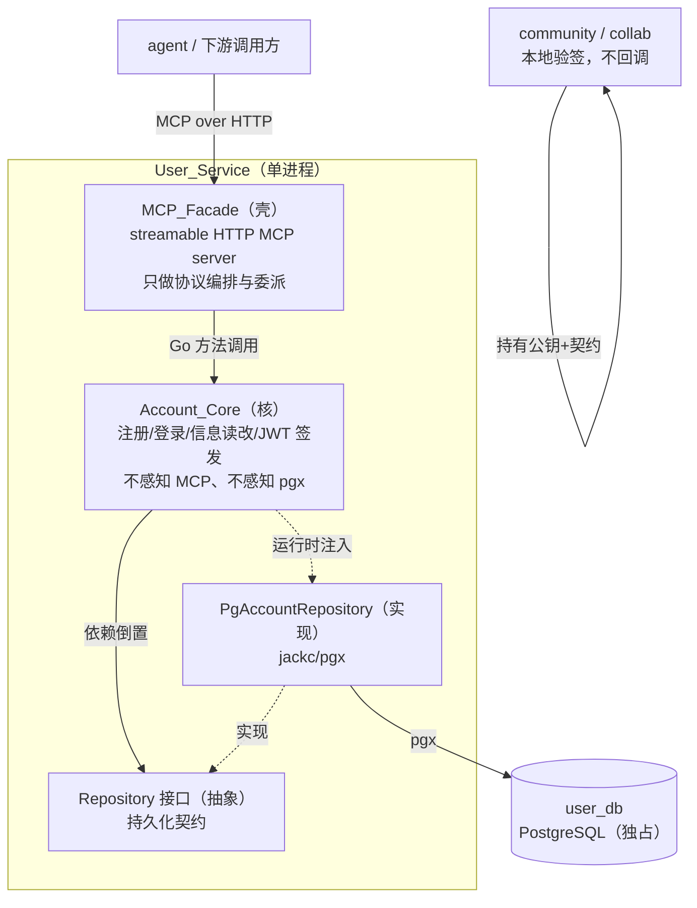

# Design Document

## Overview

一句话：**user 服务是一层薄 MCP 门面 + 一个重账号核 + 一层 Repository 持久化，三层单向依赖，核不感知协议、不感知数据库。** 门面只把 streamable HTTP MCP 的 tool 调用翻译成对 Account_Core 的方法调用；账号逻辑（注册、登录、信息读改、JWT 签发、密码哈希）全沉在核；核经 Repository 接口触达 user_db，不认 pgx。

这层地基立住后，community / collab 只需拿到 user 公布的验签公钥与契约，就能本地验 JWT、认 user_id，不回调 user。

### 与 requirements 的一处对齐（传输形态）

requirements.md 文字写的是 **stdio MCP 门面**。本 design 按已与总架构锁定的决策，把对外传输改为 **streamable HTTP MCP**（常驻服务、URL 连接），与 team-service 从 stdio 改到 streamable HTTP 的决策一致。

这个改动**只落在门面的传输适配层**，不触碰任何需求的实质：Requirement 1 要的是「对外能力只经 MCP tool 暴露、门面壳薄只编排、核不感知传输」——streamable HTTP 同样满足，且因为核本就与传输解耦（Req 1.5），换传输对核零影响。design 其余部分（核、Repository、JWT、数据模型）与 requirements 完全一致。此处为设计期发现的需求文字与锁定架构的差异，建议回填 requirements.md 的措辞；不构成需求缺口。

### 这次核心是什么

- **核心**：注册 → 登录签发 JWT → 带 JWT 读改信息 → 下游本地验签，这条最短链路，以 MCP tool 形态暴露。
- **外围（说清为什么存在，不堆）**：
  - 密码加盐哈希 —— 存在理由：库被拖走时密码不可逆、抗离线爆破。
  - 凭据无效不区分账号/密码 —— 存在理由：不给爆破者「账号名是否存在」这条侧信道。
  - TLS 强制 + dev 可关 —— 存在理由：公网不裸奔，内网开发不被阻塞，差异收敛在配置不分叉代码。

## Architecture

三层单向依赖，上层依赖下层/抽象，下层绝不反向依赖上层。



依赖方向的硬约束：

- `Facade → Core`：门面 import 核，核绝不 import 门面。核里没有一个 MCP 类型。
- `Core → Repository(接口)`：核 import 的是接口包，不 import pgx。pgx 只出现在 Repository 的 PG 实现包里。
- 组装点在 `cmd/`：由 main 把 `PgAccountRepository` 注入 `Account_Core`，把 `Account_Core` 注入 `MCP_Facade`。依赖倒置的「倒」就倒在这个组装点。

### 微内核 / plugin 的落点

- **微内核** = Account_Core 的机制（哈希、签发、校验、持久化编排），稳定不动。
- **plugin 式替换点**：Repository（换库 = 换实现）、PasswordHasher（换哈希算法）、TokenSigner（换签名算法/密钥源）。核只依赖这三个接口，实现可替换、可单测 mock。

## Components and Interfaces

### 层一：MCP_Facade（壳）

职责：起 streamable HTTP MCP server；注册 5 个 tool；把每个 tool 调用的入参解成核的请求结构，调核，把核的返回/错误翻译回 MCP 结果。**不做任何账号业务判定**（判定全在核）。

对外 5 个 MCP tool（对应 5 项对外能力）：

| tool name | 对应能力 | 委派到 Core |
|---|---|---|
| `account.register` | 注册（Req 2） | `Register` |
| `account.login` | 登录签发 JWT（Req 3） | `Login` |
| `account.get_profile` | 账号信息读（Req 4.1） | `GetProfile` |
| `account.update_profile` | 账号信息改（Req 4.2） | `UpdateProfile` |
| `account.verification_contract` | 获取验签公钥与契约（Req 5.1/5.2） | `VerificationContract` |

门面接口（Go）：

```go
// internal/facade
package facade

// MCPServer 是壳。它持有一个 Account_Core，把 tool 调用委派进去。
// 它只认 core.Account 这个接口，不认 core 的具体实现。
type MCPServer struct {
    core core.Account
}

func NewMCPServer(core core.Account) *MCPServer

// Serve 起 streamable HTTP MCP server，阻塞直至关闭。
// 传输安全（TLS 开关）从 Config 来，见 Error Handling / 配置。
func (s *MCPServer) Serve(ctx context.Context, cfg TransportConfig) error
```

门面对每个 tool 的处理一律是三步：解参 → 调 core → 译结果。tool handler 内不得出现 if 判定账号是否存在、密码是否匹配这类业务分支。

### 层二：Account_Core（核）

职责：承载全部账号业务。这是「核重」所在。核只依赖三个下层抽象：`Repository`、`PasswordHasher`、`TokenSigner`。

```go
// internal/account
package account

// Account 是核对外（对门面）暴露的唯一接口。门面只认这一个接口。
type Account interface {
    Register(ctx context.Context, name, password string) (RegisterResult, error)
    Login(ctx context.Context, name, password string) (LoginResult, error)
    // GetProfile / UpdateProfile 的入参是已验签通过的 userID。
    // JWT 的「验签 + 取 userID」是核的职责（TokenSigner.Verify），
    // 门面只负责把 raw token 透传给核，核内先验签再执行。
    GetProfile(ctx context.Context, token string) (Profile, error)
    UpdateProfile(ctx context.Context, token string, patch ProfilePatch) (Profile, error)
    VerificationContract(ctx context.Context) (Contract, error)
}

type RegisterResult struct {
    UserID string
}

type LoginResult struct {
    UserID string
    Token  string // 签发的 JWT
}

type Profile struct {
    UserID      string
    Name        string
    DisplayName string
    // 绝不含 password / password_hash（Req 4.4）
}

type ProfilePatch struct {
    DisplayName *string // 指针区分「不改」与「改为空」
}

type Contract struct {
    Algorithm   string // 如 "EdDSA"
    PublicKey   string // PEM 编码的 Ed25519 公钥
    UserIDClaim string // user_id 所在 claim 名，如 "sub"
}
```

核依赖的三个替换点接口：

```go
// 持久化抽象（依赖倒置核心，Req 6.1）
type Repository interface {
    // Create 落库；账号名唯一冲突时返回 ErrNameTaken（Req 2.4）。
    Create(ctx context.Context, a AccountRecord) error
    FindByName(ctx context.Context, name string) (AccountRecord, error) // 不存在返回 ErrNotFound
    FindByID(ctx context.Context, userID string) (AccountRecord, error)
    UpdateProfile(ctx context.Context, userID string, patch ProfilePatch) (AccountRecord, error)
}

// 密码哈希替换点（argon2id，见 Data Models / 决策）
type PasswordHasher interface {
    Hash(password string) (string, error)           // 返回自带盐与参数的编码串
    Verify(password, encodedHash string) (bool, error)
}

// 签名替换点（EdDSA，见 JWT 契约）
type TokenSigner interface {
    Sign(claims Claims) (string, error)
    Verify(token string) (Claims, error)             // 验签 + 过期校验；失败返回 ErrInvalidToken
    Contract() Contract                              // 公布算法 + 公钥 + user_id claim 名
}
```

核的构造（组装点在 cmd 注入三个依赖）：

```go
func NewAccountCore(repo Repository, hasher PasswordHasher, signer TokenSigner, clk Clock) Account
```

`Clock` 抽出来是为了让「过期」可测（PBT 里能快进时间）。

### 层三：Repository 的 PG 实现

职责：用 jackc/pgx 实现 `Repository` 接口访问 user_db。pgx 只在这一个包里出现。

```go
// internal/account/pgrepo
package pgrepo

type PgAccountRepository struct {
    pool *pgxpool.Pool
}

func NewPgAccountRepository(pool *pgxpool.Pool) *PgAccountRepository
// 实现 account.Repository 的四个方法。
// 账号名唯一性靠 user_db 的 UNIQUE 约束兜底，捕获唯一冲突译为 account.ErrNameTaken。
```

## Data Models

### Account 在 user_db 的 schema

单表 `accounts`（MVP 领域核只有 Account 一个实体，不提前拆表）：

```sql
CREATE TABLE accounts (
    user_id       UUID        PRIMARY KEY,              -- 全局唯一标识（Req 2.6）
    name          TEXT        NOT NULL UNIQUE,          -- 登录账号名，唯一（Req 2.4 兜底）
    password_hash TEXT        NOT NULL,                 -- argon2id 编码串，含盐与参数（Req 2.2/2.3）
    display_name  TEXT        NOT NULL DEFAULT '',      -- 账号基本信息（Req 4）
    created_at    TIMESTAMPTZ NOT NULL DEFAULT now(),
    updated_at    TIMESTAMPTZ NOT NULL DEFAULT now()
);
```

设计决策：

- **user_id 用 UUID（v4）**。理由：User_Service 是 user_id 唯一签发者（Req 5.3），UUID 可在服务侧本地生成、无需协调即全局唯一、不泄露注册顺序/规模（相比自增 ID）。生成放在核（`Register` 内），不依赖 DB 序列，保证「签发权在核」而非「签发权在库」。
- **password_hash 只存编码串**，格式自带算法标识、盐与代价参数（argon2 的 PHC 串如 `$argon2id$v=19$m=...,t=...,p=...$salt$hash`），换参数不改表结构。
- **name UNIQUE 约束**：唯一性最终由 DB 兜底，核先查后插仍可能并发撞车，靠 UNIQUE 约束 + 冲突捕获保证 Req 2.6 在并发下也成立。

### 密码哈希算法决策：argon2id

选 **argon2id**（而非 bcrypt / PBKDF2 / scrypt）。理由：

- **抗 GPU/ASIC 爆破**：argon2id 是内存硬（memory-hard）算法，爆破需占大量内存，显著抬高离线爆破成本；bcrypt 内存占用固定且小，对 GPU 阵列抵抗弱。
- **现代推荐**：argon2id 是 OWASP 密码存储首选、Password Hashing Competition 冠军，混合 argon2i（抗侧信道）与 argon2d（抗 GPU）两者优点。
- **参数可调且自描述**：代价参数编码进哈希串，未来调强不破坏旧数据（旧串按旧参数验签、下次登录可重哈希）。

MVP 参数基线（可配）：memory=64MB、iterations=3、parallelism=1、saltLen=16、keyLen=32，按 OWASP 基线起步。

## Correctness Properties


*一条属性是在系统所有合法执行中都应成立的特征或行为——是对「系统应当做什么」的形式化陈述。属性把人读的规格和机器可验的正确性保证连接起来。*

下列属性经 prework 分析后去冗得到（登录的 user_id 与签发往返合并，凭据无效的三条失败路径合并为「不可区分」一条，结构/配置类需求以静态检查与冒烟覆盖、不转为属性）。每条属性经单个 property-based test 实现，最少 100 次迭代；Repository/Hasher/Signer 可用内存实现以压低成本。

### Property 1: 门面委派保真

*For any* 合法的 MCP tool 调用，MCP_Facade 处理后应恰好调用 Account_Core 的对应方法一次，且入参原样透传、门面自身不做任何业务判定。

**Validates: Requirements 1.3**

### Property 2: 注册后可按名查回且 user_id 一致

*For any* 合法的账号名与密码，注册成功后按该账号名查询应查回一条记录，且返回的 user_id 与查回记录的 user_id 相等。

**Validates: Requirements 2.1**

### Property 3: 密码哈希往返正确

*For any* 密码字符串，注册后取库中 password_hash，用原密码 Verify 应为真、用任一不同密码 Verify 应为假。

**Validates: Requirements 2.2**

### Property 4: 不以明文存储密码

*For any* 密码字符串，注册后库中存储的 password_hash 都不等于该明文密码、也不包含该明文作为子串。

**Validates: Requirements 2.3**

### Property 5: 同名注册被拒且不产生重复

*For any* 账号名，用其注册两次时第二次应返回账号名已存在错误，且库中该账号名始终只有一条记录。

**Validates: Requirements 2.4**

### Property 6: user_id 全局唯一

*For any* 注册序列，所有注册成功所产出的 user_id 两两互不相同。

**Validates: Requirements 2.6, 5.3**

### Property 7: 缺字段注册被拒

*For any* 账号名或密码为空/全空白的注册输入，注册应返回字段缺失错误，且库中不新增记录。

**Validates: Requirements 2.5**

### Property 8: 登录往返

*For any* 已注册账号，用其正确凭据登录应返回与注册相同的 user_id 以及一枚 JWT，该 JWT 经验签通过、其 user_id 声明等于该账号的 user_id、其过期时间晚于签发时刻。

**Validates: Requirements 3.1, 3.2**

### Property 9: 凭据无效不可区分

*For any* 「不存在的账号名」登录输入与 *for any* 「存在但密码错误」的登录输入，两者返回的错误应是同一个凭据无效错误（类型与对外可见信息一致），不泄露账号名是否存在。

**Validates: Requirements 3.3, 3.4, 3.5**

### Property 10: Profile 读取映射正确

*For any* 已注册并登录的账号，用其 JWT 读取账号信息应返回该账号自身的基本信息（user_id 与账号名与注册一致）。

**Validates: Requirements 4.1**

### Property 11: 信息修改写-读往返

*For any* 持有有效 JWT 的账号与 *for any* 合法的信息修改补丁，先改后读应得到修改后的值，且该值已持久化到库中。

**Validates: Requirements 4.2**

### Property 12: 坏 token 被拒且无副作用

*For any* 被篡改、已过期或格式非法的 JWT，账号信息读与改都应返回凭证无效错误，且不改变库中任何数据。

**Validates: Requirements 4.3**

### Property 13: Profile 不泄露密码

*For any* 账号，读取其 Profile 的结果中都不包含密码或密码哈希（结构无该字段、序列化结果不含哈希子串）。

**Validates: Requirements 4.4**

### Property 14: 验签契约自洽往返

*For any* 登录签发的 JWT，用 VerificationContract 公布的公钥与算法独立本地验签应通过，且从契约声明的 user_id 声明字段取出的值等于登录账号的 user_id（无需回调 User_Service）。

**Validates: Requirements 5.2, 5.4**

## JWT 契约

下游（community / collab）本地验签全靠这份契约。契约由 `account.verification_contract` tool 公布。

### 签名算法决策：EdDSA（Ed25519）

选 **EdDSA / Ed25519**（而非 RS256 / ES256 / HS*）。理由：

- **无参数陷阱**：RS256 需管理 2048/4096 位模数、padding（PKCS#1 v1.5 vs PSS）等易错项；Ed25519 曲线与参数固定，没有「选错位数/padding」的坑。
- **密钥短、验签快**：Ed25519 公钥 32 字节，验签比 RSA 快一到两个数量级——下游每次请求都要本地验签，验签速度直接影响下游吞吐。
- **非对称，契合职责**：私钥仅 user 签发用、公钥对外公布验签，天然匹配「user 是签发者、下游只验签」的无状态模型。HS*（对称）会迫使把签名密钥分发给下游，违背「私钥只在 user」。

### Claims 结构

```jsonc
{
  "sub": "<user_id>",        // user_id 声明字段（契约里 UserIDClaim = "sub"）
  "iss": "maker-cloud/user", // 签发者
  "iat": 1710000000,         // 签发时刻
  "exp": 1710003600          // 过期时刻（MVP 基线 1h，可配）
}
```

user_id 放 `sub`（subject）是 JWT 标准语义——令牌主体就是账号，下游取 `sub` 即得 user_id。

### 公布的契约结构

`VerificationContract` 返回：

```jsonc
{
  "algorithm":    "EdDSA",
  "public_key":   "-----BEGIN PUBLIC KEY-----\n...Ed25519...\n-----END PUBLIC KEY-----",
  "user_id_claim": "sub"
}
```

下游拿到这三项即可：按 `algorithm` 选验签器、用 `public_key` 验签、验签通过后从 `user_id_claim` 指定字段取 user_id。全程不回调 user（Req 5.4）。

### 密钥注入方式

- **私钥**：经环境变量 `USER_SIGNING_PRIVATE_KEY`（PEM）注入，仅 user 进程持有，不入库、不进仓库（Req 5.5 / 7.4）。启动时加载进 `TokenSigner`；缺失则启动失败（fail fast，不静默降级）。
- **公钥**：由私钥派生或经 `USER_SIGNING_PUBLIC_KEY` 注入，随契约对外公布。

## 关键流程

### 注册（account.register）

1. 门面收到 tool 调用，解出 `name`、`password`，调 `Core.Register`。
2. 核校验 name/password 非空白（空白→字段缺失错误，Req 2.5）。
3. 核调 `PasswordHasher.Hash(password)` 得加盐哈希串。
4. 核本地生成 UUID 作 user_id。
5. 核调 `Repository.Create`；若撞 name UNIQUE 约束→ `ErrNameTaken`（Req 2.4）。
6. 核返回 user_id，门面译为 tool 结果。

### 登录（account.login）

1. 门面解出 `name`、`password`，调 `Core.Login`。
2. 核 `Repository.FindByName`；不存在→返回 `ErrInvalidCredentials`（**不提前返回「账号不存在」**）。
3. 核 `PasswordHasher.Verify(password, record.hash)`；不匹配→同样返回 `ErrInvalidCredentials`（与上一步同一错误，Req 3.5）。
4. 匹配：核构造 claims（sub=user_id, iat, exp），调 `TokenSigner.Sign` 私钥签名。
5. 核返回 `{user_id, token}`。

### 带 JWT 的信息读 / 改（account.get_profile / account.update_profile）

1. 门面把 raw token（及改请求的 patch）透传给核，**不自己验签**。
2. 核 `TokenSigner.Verify(token)`：验签 + 过期校验；失败→ `ErrInvalidToken`（Req 4.3）。
3. 从 claims 取 `sub` 作 user_id。
4. 读：`Repository.FindByID` → 组 `Profile`（**剔除 password_hash**，Req 4.4）返回。
5. 改：`Repository.UpdateProfile(userID, patch)` 持久化后返回更新后的 `Profile`。

### 下游本地验签（community / collab 侧）

1. 下游启动期调一次 `account.verification_contract` 拿 `{algorithm, public_key, user_id_claim}`，缓存。
2. 收到带 JWT 的请求时，用缓存公钥按 algorithm 本地验签。
3. 验签通过→从 `user_id_claim`（`sub`）取 user_id，认定请求者身份。
4. 全程不回调 user（Req 5.4）。公钥轮转时下游重新拉取契约。

## Error Handling

错误处理策略：错误在核里分类，门面只做翻译，不新增业务错误。核的错误集（稳定、可被下游/测试断言）：

| 错误 | 触发 | 对外信息 | 为什么这样 |
|---|---|---|---|
| `ErrFieldMissing` | 注册缺 name/password | 「账号名或密码不能为空」 | 明确指引，无安全敏感 |
| `ErrNameTaken` | 注册撞已存在账号名 | 「账号名已存在」 | 注册阶段账号名是否可用本就需告知用户 |
| `ErrInvalidCredentials` | 登录账号不存在 **或** 密码错 | 「账号名或密码错误」 | **两路合一**：不暴露账号名是否存在这条爆破侧信道（Req 3.5） |
| `ErrInvalidToken` | 验签失败/过期/格式非法 | 「登录状态无效，请重新登录」 | 不区分「签名坏」与「已过期」，不给攻击者可利用的细分 |

安全侧的三条硬策略：

- **凭据无效单一出口**：登录失败路径（账号不存在 / 密码错）在核内归一到同一个 `ErrInvalidCredentials` 值，错误消息、错误码、响应形态完全一致。禁止在「账号不存在」路径提前返回不同错误——这是 Property 9 守护的。
- **门面不吞错、不改语义**：门面把核错误映射为 MCP 的 `isError` 结果，保留错误类别，但不把核的内部细节（堆栈、SQL、哈希参数）外泄。
- **fail fast 于启动**：私钥 / DB 凭据缺失、公网未配 TLS，一律启动期报错退出，不运行到一半才暴露。

## Testing Strategy

PBT 适用性判断：Account_Core 是近乎纯的业务逻辑（哈希往返、签发/验签往返、唯一性、凭据不可区分不变量），Repository/Hasher/Signer 均为可替换接口、可用内存实现 mock，行为随输入显著变化——**PBT 适用，对核**。门面的协议编排、Repository 的 pgx 实现、TLS/配置属于传输与外部依赖——**PBT 不适用，用示例/集成/冒烟**。

### 属性测试（对 Account_Core）

- 库：**rapid**（`pgregory.net/rapid` v1.3.0，Go 原生 property-based 库）。不自实现。
- 每条 Property（1–14）由**单个** property-based test 实现，最少 **100** 次迭代。
- 每个属性测试加注释标签：`// Feature: mvp-account, Property {number}: {property_text}`。
- 测试跑在内存 Repository + 内存 Hasher（可配低成本参数）+ 内存 TokenSigner 之上，与 I/O 解耦。
- `Clock` 注入假时钟，使 Property 8/12 的「过期」可控、可快进。

### 示例 / 单元测试

覆盖结构与具体场景（不转属性的部分）：

- tool 注册表恰含 5 个约定 tool（1.2）。
- 静态依赖检查：`internal/account` 不 import MCP/传输包、不 import pgx（1.4 / 1.5 / 6.1）。
- `VerificationContract` 返回合法 PEM 公钥（5.1）。
- 配置加载：缺私钥/DB 凭据→启动失败；公网未配 TLS→启动失败；dev 明文可启动（5.5 / 7.1 / 7.2 / 7.3 / 7.4）。

### 集成测试（对 pgx 实现与 user_db）

- 针对容器化 PostgreSQL，跑 `PgAccountRepository` 的 Create/FindByName/FindByID/UpdateProfile 往返（1–3 例，含 name UNIQUE 冲突→ErrNameTaken 的映射）（6.2）。
- 一条端到端：起门面（MCP over HTTP）→ register → login → get_profile → 用契约公钥离线验签，贯通整条链路。

### 冒烟测试

- 启动门面确认 streamable HTTP MCP server 监听、tool 列表非空（1.1）。
- 连接目标为 user_db、无 community/collab 库连接（6.3）。

## 目录结构

常规 Go 服务布局：`cmd/` 放可执行入口与组装，`internal/` 按领域分包，领域核与传输/持久化各自独立包，依赖方向单向向下。

```
services/user/
├── cmd/
│   └── user-service/
│       └── main.go              # 唯一组装点：装配 Config→pgxpool→PgRepo→Core→MCPServer，起 Serve
├── internal/
│   ├── facade/                  # 壳：streamable HTTP MCP server + 5 个 tool handler
│   │   ├── server.go            # MCPServer, NewMCPServer, Serve
│   │   └── tools.go             # 5 个 tool 的解参/委派/译结果（无业务判定）
│   ├── account/                 # 核：Account 领域核（核重所在）
│   │   ├── account.go           # Account 接口 + 实现（Register/Login/GetProfile/UpdateProfile/VerificationContract）
│   │   ├── model.go             # AccountRecord/Profile/ProfilePatch/Claims/Contract/Result 结构
│   │   ├── errors.go            # ErrFieldMissing/ErrNameTaken/ErrInvalidCredentials/ErrInvalidToken
│   │   ├── repository.go        # Repository 接口（持久化抽象）
│   │   ├── hasher.go            # PasswordHasher 接口 + argon2id 实现
│   │   ├── signer.go            # TokenSigner 接口 + EdDSA 实现 + Contract
│   │   └── pgrepo/              # Repository 的 pgx 实现（pgx 只在此出现）
│   │       └── pg_repository.go # PgAccountRepository
│   └── config/
│       └── config.go            # 环境变量加载：私钥/DB 凭据/TLS 开关；fail fast
├── migrations/
│   └── 0001_accounts.sql        # accounts 表 DDL
├── go.mod
└── go.sum
```

领域边界落点：`account` 是领域核一个包（DDD 的 Account 领域），`facade` 是传输壳，`pgrepo` 是持久化实现。核不感知另两者。不提前拆多领域包（MVP 领域核只有 Account）。

## 依赖清单（锁版本）

按工程准则第八条，新依赖的安装由总架构评估（主流、维护活跃、许可宽松、非 typosquatting）后安装验证；此处列清并锁版本，**均已获总架构批准**。版本为锁定值、精确 pin（=x.y.z），非开放区间、不开 caret。

| 依赖 | 锁定版本 | 用途 | 状态 |
|---|---|---|---|
| Go module 名 `github.com/xt-line/maker-kit/maker-cloud/services/user` | — | 本服务 module | 本仓库自有 |
| Go toolchain | 1.27+ | 语言/运行时 | 已锁定（总架构） |
| `github.com/jackc/pgx/v5` | v5.7.2 | PostgreSQL 驱动 + 连接池（pgxpool） | **已批准** |
| `github.com/golang-jwt/jwt/v5` | v5.2.1 | JWT 签发/验签（支持 EdDSA/Ed25519） | **已批准** |
| `golang.org/x/crypto` | v0.31.0 | argon2id 密码哈希（`golang.org/x/crypto/argon2`）+ Ed25519 辅助 | **已批准** |
| `github.com/google/uuid` | v1.6.0 | user_id（UUID v4）生成 | **已批准** |
| `github.com/modelcontextprotocol/go-sdk` | v1.8.0 | 对外 streamable HTTP MCP server | **已批准（总架构统一选型，与 team-service / iot-cloud / build-service 全系一致）** |
| `pgregory.net/rapid` | v1.3.0 | property-based 测试（仅测试依赖） | **已批准** |

两点说明：

1. **MCP Go SDK 选型**：已确定：`github.com/modelcontextprotocol/go-sdk` v1.8.0（全系统一）。user 对外走 streamable HTTP MCP，与 team-service / iot-cloud / build-service 用同一 SDK/版本，统一门面写法。
2. Ed25519 由标准库 `crypto/ed25519` 提供签名原语，`golang-jwt/jwt/v5` 负责 JWT 封装；两者配合即可，无需额外 Ed25519 库。
